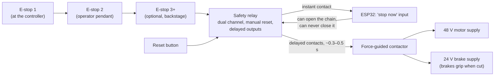
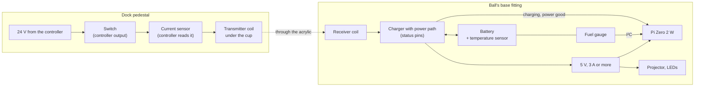
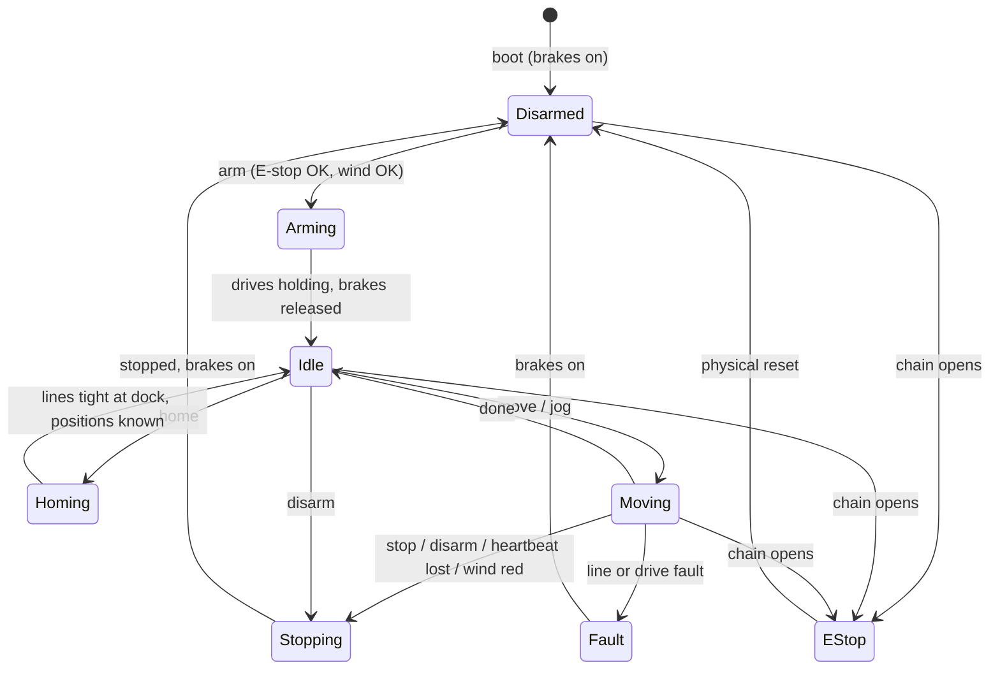
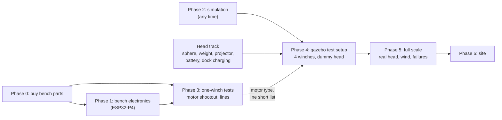

# Flying Leota: project plan

A head that floats in the air, held by four motor-driven lines. The motion controller
is an ESP32 with wired Ethernet and a local touchscreen. Show Controller controls it
over the Show Controller Motion Protocol (SCMP).

Status, November 2026: planning done. The motion core (`core/`) and the PC simulator
(`sim/`) are written and tested, and Show Controller flies the simulated head through its
own SCMP client and Motion page. The touchscreen (`ui/`) is built in LVGL and runs inside
the simulator's page, with every setting editable from Setup, a line test for each load cell
and drum, and a calibration check that flies the ball and works out where the pulleys
really are. No hardware yet. Every "Proposed" item below needs a yes from
Nate before it is built.

## Summary

- **The prop:** a lifesize head inside a 14 in (0.36 m) clear crystal ball, likely 3–5 kg.
  It rests on a pedestal 0.75 m up, in the middle of a rigid metal gazebo. It rises about
  24 in (0.6 m) and drifts about ±27 in (0.68 m) each way, always facing the audience. A
  projector, a Raspberry Pi Zero 2 W and a battery ride inside.
- **The rig:** four winches at the bases of the gazebo's four corner poles. Each line runs
  up its pole, over a pulley at 79 in (91 in apart) and down to a small fitting on top of
  the ball, like Skycam. The same hardware flies in 3 axes, or in a fixed depth plane.
- **The controller:** an ESP32-P4 board with wired Ethernet and a 7 in touchscreen. Show
  Controller drives it over SCMP as three axes: x, y and z. The touchscreen shows status
  and has local controls: remote on/off, arm, home, park and stop.
- **The motors:** closed-loop steppers with fail-safe brakes are the lead choice. ODrive
  brushless servos are the alternative. One of each gets tested before buying four.
- **Safety:** two or more hardwired E-stops through a safety relay. A controlled stop,
  then power off, and the brakes hold the ball. The firmware keeps its own limits,
  tension checks and a network heartbeat. Software is never the only safety layer.
- **Weather:** a wind sensor plus line-tension monitoring. Green, amber and red levels.
  At red, the ball flies home to the dock and locks out until conditions settle.
- **Next:** buy the bench parts (about $800–1,100), then run two test tracks side by side:
  motion (one winch, both motor types, line samples) and the head (sphere, projector,
  power, weight).

## 1. Goals

| # | Goal |
| --- | --- |
| G1 | Move a head-sized prop in 3 axes (left/right, up/down, toward/away), like Skycam. A fixed-depth plane (2 axes) is an acceptable fallback. |
| G2 | Show Controller drives it over Ethernet with SCMP. No Wi-Fi anywhere in the control path. |
| G3 | A local touchscreen shows status. It also has controls to enable or disable remote control, arm and disarm, home, park and stop. |
| G4 | At least two hardwired emergency stops. They work even if the software is dead. |
| G5 | It runs outdoors in a gazebo, enclosed on 3 sides and seen from 1 side. It has clear wind rules and enforces them itself. |

Non-goals for version 1: turning or tilting the head, and more than one flying object.
The head's own projector and LEDs run on their own battery and are not part of the motion
controller.

### Site and prop (from Nate, measured on this year's setup, 2026-11-05)

| Item | Value |
| --- | --- |
| Structure | A gazebo: a rigid metal frame that can be broken down. It can carry the rig directly, with stakes or weights added to the four corner poles if needed. No separate truss. Curtains close 3 sides. |
| Pick points | A square: the post centers are 91 in (2.31 m) apart both ways. The posts are 70 in (1.78 m) tall. A metal corner piece of the roof frame runs straight up from each post top to 79 in (2.01 m). The pulleys mount at the top of those corner pieces, directly above the post centers. |
| Roof | A soft top: a fabric canopy over a light steel frame, with a small raised vent tier at the top. Thin rafters run from each corner up to the center, and arched braces tie each post to the beams. Same style as a Kozyard soft-top grill gazebo. 100 in (2.54 m) inside at the peak. |
| Dock | A pedestal fixed to a table in the middle of the gazebo, its top 0.75 m (30 in) off the deck. The head rests here when it isn't flying. |
| Head | Lifesize, inside a clear sphere made to look like a crystal ball, 13–14 in (0.33–0.36 m) across. A large curly wig. Weight not known yet. This year's head is fixed on the pedestal, with front projection onto a blank face. A flying head needs the projector inside instead, so the image moves with it. |
| Facing | **The face must always point towards the audience.** |
| On board | A Raspberry Pi Zero 2 W drives a small laser projector in the neck (an Ultimems HD309D1-C1, being sourced). A mirror throws the image onto the back of the face. Maybe LEDs. All on a lithium-ion battery. No power through the lines: they stay as thin as possible. Projector not chosen yet. |
| Viewing | At night, in low light. The lines should vanish into the dark. |

This is like the séance-room crystal ball: it sits on the table, rises, drifts and floats,
and settles back. That fits the space well, because the space is small (section 4).

## 2. How it works

### Layout (proposed: Skycam style)

```
  Top view

   A (back left post) ●───────────────────────────● B (back right post)
                        ╲                       ╱
                          ╲      ┌───────┐    ╱
                            ╲────┤ head  ├──╱        each line: winch at the post base,
                            ╱────┤       ├──╲        up the post, over the top pulley,
                          ╱      └───────┘    ╲      down to one corner of the head's
                        ╱                       ╲    hidden top frame
   C (front left post) ●───────────────────────────● D (front right post)

                     ▲  audience looks in from the front (open side)
```

- The gazebo's four corner posts, 91 in apart. Each has a pulley at 79 in, on the roof's
  corner piece above the post. Seen from above, the head is always inside that square.
- Each line runs from a winch at the **base** of its post, up the post, over the top
  pulley, and down to the head. Skycam does the same thing. Heavy parts stay low and
  easy to reach, and the tops of the posts carry only pulleys.
- Gravity keeps the lines tight. The head hangs below the pulleys. It can't go above
  their plane, and it gets harder to hold as it nears that plane or a corner (section 4).
- The four lines attach to four points about 10 cm apart on a small fitting at the top
  of the ball (like the corners of Spidercam's camera dolly, but much closer together). If
  they all went to one point, the ball could spin. With four points, the face stays
  towards the audience. Section 4 explains the spacing.
- **The same hardware does both modes.** The 2-axis mode is a software setting: the
  depth axis is fixed at one value. Nothing is rebuilt to switch.

Why not the other layouts:

| Layout | Axes | Problem for this prop |
| --- | --- | --- |
| 2 lines from the top (a "polargraph") | 2 | Nothing holds the depth. A breeze from the open side swings it like a pendulum. |
| 2 lines from the top and 2 from the floor, in one plane | 2 | Stiff side to side, but depth is held only by line tension. That is the direction the wind blows through an open gazebo front. The floor lines are also in the scene. |
| 8 lines (fully held) | 3 + turning | Twice the hardware. Lines cross the scene from below. |
| **4 lines from the top (Skycam)** | **3, or 2** | **Recommended.** Front and back lines hold the depth directly. |

### Mounting on the gazebo

The gazebo's steel frame carries the pulleys and winches directly. No separate truss is
needed. It is a light frame with a fabric roof, though, so three things need checking,
because if the posts move, the head moves:

- **Inward pull.** The lines pull each corner towards the center, by up to about 120 N
  for a 5 kg head at the top of its travel (section 4). Test it before building: run a
  ratchet strap with a luggage scale between two opposite corners at 79 in, pull to about
  150 N, and measure how far the corners move. A few millimetres is fine. More than that
  needs bracing at the corners. A brace straight across the top, corner to corner, could
  touch the lines when the ball is high and off center, so keep bracing near the corners.
  Also try the pull with the ball off center: then the corners are pulled unevenly, which
  tries to rack the frame out of square.
- **Wind on the canopy.** A fabric roof is a sail. It pushes the frame sideways and can
  lift it. **Stake or weight every leg**: with a soft top this is a must, not an option.
  Tie the canopy down tight so it doesn't flap.
- **Canopy flapping.** A flapping canopy shakes the frame, and the pulleys are on the
  frame, so the ball would shiver. Check it in the Phase 5 wind tests. The tension-swing
  check (section 6) notices if the frame is moving.

Each winch clamps to the bottom of its post. The line runs straight up the post through
small guides to the pulley on the corner piece at 79 in. The corner, where the post, the
beams and the rafter meet, is the stiffest point of the frame, which suits the pull. The
rafters are thin tubes, another reason not to put pulleys on them.

### Lines

The goal is lines you can't see against a black curtain, that don't stretch, and that
stay the same length all evening. Choose the line by testing (Phase 3). For now:

| Line | Visibility | Stretch and creep | Notes |
| --- | --- | --- | --- |
| Nylon monofilament (clear) | Good at any color backdrop | High. Stretches noticeably under load, creeps, and **changes length when wet or humid**. | Needs constant re-trimming. Least suited to a damp outdoor gazebo. |
| Fluorocarbon (clear) | Good | Lower than nylon, still meaningful | Stiff, and has memory on a drum. |
| **Braided UHMWPE (Dyneema/Spectra) fishing line, black, about 90–265 lb test** (by head weight and top clearance, section 4) | Thin (roughly 0.5–0.7 mm). Disappears against black. | Very low | **Recommended starting point.** Strong for its size. Spools well on a grooved drum. |

Pick the line size from the loads in section 4. Theatre rigging commonly uses large design
factors (often 8:1 to 10:1). Section 7 lists this as an open question.

## 3. Hardware recommendations

### 3.1 Controller: ESP32-P4

The ESP32-P4 is the only ESP32 that has an Ethernet MAC and a MIPI-DSI display interface
together, with the speed to run a 7-inch UI and motion together.

| Chip | Ethernet | Display | Verdict |
| --- | --- | --- | --- |
| ESP32 (original) | Built-in MAC, RMII PHY | SPI or parallel only. A 7-inch UI is slow. | Workable, but tight. |
| ESP32-S3 | **No MAC.** Needs a W5500 over SPI. | RGB parallel works | Ethernet over SPI is slower and eats pins. |
| **ESP32-P4** | **Built-in MAC, RMII PHY** | **MIPI-DSI, 2D accelerator** | **Recommended.** Dual-core RISC-V at 360–400 MHz, 3 CAN (TWAI) controllers, 4 RMT channels (step pulses), and lots of GPIO. |

The P4 has no radio, which suits the no-Wi-Fi rule. Most P4 boards add an ESP32-C6 for
Wi-Fi. We leave it turned off.

Boards (all have Ethernet and a DSI connector):

| Board | Screen | About | Use |
| --- | --- | --- | --- |
| **Espressif ESP32-P4-Function-EV-Board** | 7" 1024×600 capacitive touch, in the kit | $55+ (board); more with the display kit | **Bench and first build.** Espressif's own board, with the best ESP-IDF board support (esp-bsp). IP101 Ethernet PHY. |
| Waveshare ESP32-P4-Module-DEV-KIT-B | 7" DSI touch, in the kit | ~$78 kit | Alternative. 40-pin GPIO header, optional PoE. |
| Olimex ESP32-P4-DevKit | Add a DSI panel | €16 | Open-source hardware. Good for the final build on a custom I/O carrier board. |
| Waveshare ESP32-P4-ETH / -POE-ETH | Add a DSI panel | $25+ | Small and simple, if we design our own carrier. |

Waveshare's all-in-one P4 touch panels (4.3", 5", 7", 10.1") have **no Ethernet**, so
they don't fit.

For the field build, plan a small **I/O carrier board** (or DIN-rail terminal breakouts)
between the ESP32 and the outside world:

- Opto-isolated 24 V inputs: E-stop chain status, reset, drive alarms (×4), and the
  Local/Remote key.
- Differential step/dir outputs (26LS31 line driver) to the drives.
- 2 CAN transceivers (drives or I/O later), 1 RS-485 transceiver (anemometer).
- A watchdog "charge pump" output. The drives' enable line stays on only while the
  firmware keeps toggling a pin. A hung ESP32 drops the enable. Classic CNC practice.
- Load cell amplifier inputs (×4).

### 3.2 Winches: motors and drives

Load numbers come from section 4. The head's weight isn't known yet, so **size the
winches for a 6 kg head**: up to about 150 N on a line at the worst spot in the workspace.
The ball is lighter than first assumed, but the gazebo's low pulleys make the lines
shallower, and shallow lines pull harder. So the winch size comes out about the same.
Lighter heads just run with more margin. With a 12 mm radius drum (24 mm across),
150 N is 1.8 N·m. The space is small, so the head moves slowly: 0.3 m/s line speed is about
240 rpm at the drum. A 3 N·m NEMA 23 does this directly, with no gearbox, because stepper
torque is highest at low speed. Its brake must hold at least 2 N·m.

Sizing with margin costs little on the motor side: the same motor class and a smaller
drum. The real cost of a heavy head, or of flying close to the pulleys, is thicker line
(section 4).

**A hanging load needs brakes.** If drive power drops (E-stop, power cut, fault), an
unbraked motor lets the head fall. Use fail-safe brakes, which grip when power is
removed. Removing drive power then engages the brakes too, which matches SCMP's
"E-stop removes drive power" rule.

| Option | Per winch | For | Against |
| --- | --- | --- | --- |
| **A. Closed-loop stepper, NEMA 23, 2–3 N·m, with a 24 V fail-safe brake.** Drive: StepperOnline CL57T V4.1 class, or Leadshine CS-D507E with the CS-M22313B brake motor. 48 V DC. Step/dir input, alarm output. | ~$150–250 | **Recommended for version 1.** Simple, cheap, high holding torque, brakes available. The encoder catches missed steps, and the drive raises an alarm on following error. | No direct torque control, so line tension is managed through load cells (section 4). |
| B. Brushless servo: ODrive S1 + M8325s motor, controlled over CAN, plus a separate brake. | ~$300–350 + brake | Torque mode controls line tension directly. Motor current gives a tension reading. Hangprinter's cable printer is built this way. | More tuning. Brake and drum need custom mounts. Often out of stock. |
| C. Teknic ClearPath-SDSK integrated servo | ~$385–600 | Excellent, all in one, step/dir. | Expensive, and no brake option was found. |
| D. MKS SERVO57D (CAN or RS-485 closed-loop stepper) | ~$50–80 | Cheap. Good for bench experiments. | Thin documentation. Unproven for a hanging load. |

Recommendation: **build version 1 on Option A, and write the firmware with a drive
interface** so Option B can replace it later without changing the rest. One caveat: noise.
The audience is close, at night, in a quiet scene, and steppers hum or whine. Buy one of
each for Phase 3 (a single winch) and listen to both under load before buying four.

#### Closed-loop stepper or ODrive: the difference

Both are a motor, an encoder that measures where the shaft is, and a drive that powers the
motor. They differ in **what you tell the drive**.

**Closed-loop stepper: "be at this position."** The ESP32 sends step pulses. Each pulse
means "turn one tiny fixed angle more." The drive pushes as hard as it needs to keep the
shaft exactly where the pulses say. The encoder lets it correct a slip, and it raises an
alarm if it can't keep up. It's like telling someone "hold your hand exactly here." They
will, however hard you push, until they give up.

- It holds a hanging load firmly and simply. Steppers are strongest at low speed, which is
  all this rig needs.
- Setup is wiring and a few switches. There is almost nothing to tune.
- It never says how hard it's pulling. A tight line and a slack line look the same to it.
  So we add a load cell in each line to measure tension.
- It is cheaper, and brake versions exist.
- It hums or whines, more or less depending on the drive.

**ODrive (brushless servo): "be here," "move at this speed," or "pull this hard."** The
motor is a brushless motor, like those in drones and robots. The ODrive board controls the
current in its coils directly, many thousands of times a second, and takes commands over
CAN. Current is torque, and torque on a drum is line tension. So the ODrive can be told
"pull this line with 40 N." If something pulls harder, it gives way. If the line goes loose,
it takes up the slack. It's like telling someone "keep this rope tight with this much
force." Their hand goes wherever it must.

- It can control tension directly, and it reports current, which gives a rough tension
  reading without a load cell.
- It can act like a stiff spring around a target length: hold position, but give a little.
  That is exactly what four lines on a three-axis rig need (below).
- It is very smooth and nearly silent.
- It needs tuning: control gains, and an encoder calibration. Some setups do that
  calibration by turning the motor at power-up, which a hanging head can't allow. We
  would need an absolute encoder or a saved calibration.
- It costs about twice as much, and needs a separate brake, a custom motor mount and
  drum. Stock has been patchy.

**Why the difference matters here.** Four lines hold a head that has three axes, so one
line is always extra. If all four lines are held to exact lengths, any small error (a
pulley a few millimetres off, a line that stretched) makes one line go slack or makes the
motors fight. Something must manage tension:

| With | How tension is managed |
| --- | --- |
| Closed-loop steppers | Load cells measure each line. The firmware changes the line lengths a little, many times a second, until the tensions match what the model expects. All in our software. |
| ODrive | The drives do much of it: each line acts like a spring, or one line is run in "pull this hard" mode. Load cells become a check, not the main control. |

Both work. Steppers put the tension work in our firmware but are simple to start with.
The ODrive puts it in the drive, at the price of tuning and cost.

Winch mechanics:

- A **grooved drum with a single layer of line** (a helical groove, about 1 mm pitch).
  The radius never changes, so motor angle maps exactly to line length. An 8 m line on a
  30 mm drum is about 85 turns, about 85 mm of drum.
- A fixed **fairlead** (guide roller) a short way from the drum. It keeps the line's
  path fixed as it moves along the groove.
- A **tension sensor in each line near the winch**: three rollers in a row, with the
  middle one on a small beam load cell. Line tension is proportional to the reading,
  because the line angle over the rollers never changes. Amplifier: HX711 at 80
  samples/s to start, or ADS1232 / NAU7802 for faster readings.
- Top pulleys: small sealed-bearing sheaves on swivels, black. The line leaves the
  pulley at a point that moves a little as the head moves. The kinematics model includes
  that (section 5.3).

### 3.3 Safety hardware

The E-stop works in hardware. Software only reports it.



- **E-stop buttons:** at least two. They have red mushroom heads on yellow bases, twist to
  release, and two normally closed contacts each, wired in series. One sits on the
  controller enclosure. One is on a pendant with a long cable so the operator can stand
  where they see the head. Add one backstage if crew work there.
- **Safety relay:** a dual-channel E-stop relay with manual reset and delayed outputs
  (Pilz PNOZ, Omron G9SE, Phoenix PSR families, among others). The delay gives a
  **controlled stop first, then power off** (IEC 60204-1 "category 1"). A hanging head
  shouldn't be snapped to a halt by four brakes at full speed. The ESP32 gets an instant
  signal to decelerate. If it doesn't, the delayed contacts remove power regardless.
- **Reset** is a physical button. A software command can never reset it, which matches
  SCMP's "only a physical reset closes the chain".
- **Local/Remote key switch** (recommended, in addition to the touchscreen toggle).
  Turning the key to Local locks out network control, whatever the screen says. The
  person working on the rig keeps the key.
- **Stack light or beacon:** red = E-stop, amber = armed, flashing amber = moving,
  green = safe/disarmed. The crew can see the state in the dark without the screen.
  Sound a short horn on arm.

### 3.4 Power and enclosure

- 48 V DC supply for the drives, 24 V for brakes, relays, I/O and the dock charger, and
  5 V for the ESP32 from the 24 V. Sizes below.
- An IP54 or better enclosure with the touchscreen in the door, behind a clear cover if
  rain can reach it. Glands or panel connectors for each winch. Feed it from a GFCI
  outlet.
- Drives in the main enclosure. Run motor, encoder and brake cables out to each winch
  (screened, labelled, locking connectors). Check the encoder cable length limit. If the
  posts are far apart, put each drive in a small box at its winch and send it
  differential step/dir (or CAN with Option B).

#### Power budget

These are estimates, deliberately on the high side. Phase 3 replaces them with readings
from a plug-in power meter on the one-winch rig. The ball runs on its own battery, so only
its dock charger counts here. Show Controller, the network switch, lighting and sound are
on their own supplies and not included.

| Load | Rail | Typical, show running | Most it could draw |
| --- | --- | --- | --- |
| 4 winches (drive + motor) | 48 V | 60–200 W | 400 W (100 W each, all at once) |
| 4 brakes, held released while armed | 24 V | 30–45 W | 45 W |
| ESP32-P4 board and 7" screen | 24 V (via 5 V) | 4 W | 6 W |
| Safety relay, contactor coil, I/O, load cells, anemometer, stack light, fan | 24 V | 15 W | 30 W |
| Dock charger for the ball (inductive) | 24 V | 0–35 W | 35 W |
| **Total DC** | | **about 110–300 W** | **about 515 W** |

Why the winches are budgeted so high: lifting even a 6 kg head at 0.3 m/s takes only about
18 W of actual work. But a stepper draws current to make torque whether it moves or not,
and much of that becomes heat. A closed-loop drive cuts the current when the load is
light, so holding still is cheaper than the worst case. An ODrive is more efficient again.

**Power supplies** (switch-mode, DIN rail, with power-factor correction):

| Rail | Supply | Rating | Load at worst |
| --- | --- | --- | --- |
| 48 V | Mean Well SDR-480-48 | 480 W (10 A) | about 400 W: 83% |
| 24 V | Mean Well SDR-240-24 | 240 W (10 A) | about 115 W: 48% |
| 5 V | DC-DC converter from the 24 V | about 15 W | under 10 W |

These are not old-style transformers. A switch-mode supply takes the AC mains straight in
and gives regulated DC out. Each supply limits its own current, so together they can never
draw more than their ratings.

**AC draw at 120 V** (supplies about 94% efficient, power factor about 0.95–0.99):

| Case | AC power | AC current |
| --- | --- | --- |
| Typical, show running | about 120–310 W | about 1–3 A |
| Worst-case budget above | about 550 W | about 5 A |
| **Ceiling: both supplies at full rating** | **about 770 W** | **about 6.5–7 A** |
| Switch-on surge | | about 40 A + 33 A for a few thousandths of a second |

- **Plan for 800 W, 7 A at 120 V.** The rig physically can't draw more.
- **A 15 A, 120 V GFCI circuit is plenty,** with half of it to spare. Don't share it with
  heaters, fog machines or other heavy loads, so a trip elsewhere can't drop the rig.
- **The switch-on surge** is normal for switch-mode supplies and fine for a standard
  breaker. If a GFCI trips on switch-on, power the two supplies a second apart.
- **Energy per night:** 4 hours at a generous 250 W average is about 1 kWh. That matters
  only if it runs from a generator or battery power station: size that for at least
  1,000 W continuous and 1.5 kWh.
- Lowering the ball turns the motors into generators. The energy flows back into the 48 V
  supply, which can't absorb it. With a light ball this is small, but the 48 V rail gets a
  brake resistor or voltage clamp (the ODrive needs one anyway).

### 3.5 Wind sensor

- An RS-485 Modbus anemometer at the head's height, at the open side of the gazebo. A cup
  type (for example DFRobot SEN0483, under $100) is fine to start. Many cheap ones don't
  report gusts, so the firmware computes gusts itself from fast readings.
- An ultrasonic sensor (no moving parts, reports gusts) is the upgrade: ~$300–900.
- Tension sensing (3.2) is the second, more direct wind sensor. It measures what
  actually reaches the head. See section 6.

### 3.6 Rough budget (to check before ordering)

| Part | Rough cost |
| --- | --- |
| ESP32-P4 board + 7" touchscreen | $60–100 |
| 4 closed-loop stepper + drive + brake sets | $600–1,000 |
| Power supplies (48 V, 24 V) | $120–200 |
| Safety relay, contactor, 2–3 E-stops, reset, key switch, stack light | $300–600 |
| 4 load cells + amplifiers, I/O carrier board | $150–300 |
| Anemometer | $50–900 |
| Drums, pulleys, bearings, fairleads, mounts, line | $200–400 |
| Enclosure, cable, connectors | $200–400 |
| Brackets and clamps for the gazebo poles | $100–300 |
| **Total** | **about $1,800–4,000** |

## 4. The numbers that drive the design

A quick static model (to become a proper sizing tool in Phase 0). It uses the gazebo:
pulleys 91 in (2.31 m) apart at 79 in (2.01 m). The ball is 14 in (0.36 m) across and
rests on the pedestal at 0.75 m. The four lines attach to points 10 cm apart on top of
the ball.

### The space it can fly in

| Limit | Value |
| --- | --- |
| Ball center when docked | about 0.93 m (37 in) |
| Top of the ball when docked | about 1.11 m (44 in): 0.90 m (35 in) below the pulleys |
| **Sideways, each way from center** (0.3 m clear of the curtains) | **about ±0.68 m (±27 in)** |
| **Room to rise** | **about 24–28 in (0.6–0.7 m)**, depending on how close to the pulleys it may go (below) |

Once clear of the table, the ball can also come down beside it.

**Height costs line size.** Lines get shallower as the ball nears the pulleys, and
shallow lines pull much harder. So the closer the ball may go to the pulleys, the higher
it rises, but the harder every line pulls:

| Top of ball kept below the pulleys | Room to rise | Worst line pull, per kg of head |
| --- | --- | --- |
| **0.30 m (12 in)** | **24 in (0.60 m)** | **17 N** |
| 0.20 m (8 in) | 28 in (0.70 m) | 24 N |
| 0.15 m (6 in) | 30 in (0.75 m) | 32 N |

**Proposed: start with 12 in of clearance, so 24 in of rise.** That keeps the line thin.
The winches are sized for 8 in of clearance, so if the line tests show a thicker line
still hides well, the limit can come down later. That is a setting, not a rebuild.

What sets the rise:

- **Pulleys at 79 in, on the corner pieces.** At the 70 in post tops, the ball would
  lose 9 in of rise.
- **The pedestal at 0.75 m.** That gives 10 in more rise than 1.0 m did. Every inch lower
  is an inch more.
- **Pulleys up the rafters: not worth it.** Moving them 15–30 cm up the rafters gains only
  2–3 in. It needs an extra pulley at each corner to turn the line, and it puts the pull
  into the middle of a thin rafter instead of the strong corner.

### What the head weighs

A 14 in acrylic sphere weighs:

| Wall thickness | Sphere weight |
| --- | --- |
| 2 mm | 0.95 kg |
| 3 mm | 1.4 kg |
| 4.5 mm | 2.1 kg |

Add the head form, wig, projector, Pi, mirror, battery and the fittings. Somewhere around
**3–5 kg** is likely. This year's ball can simply be weighed.

### Line tensions by head weight

Tension scales with weight. Over the whole workspace, including gentle acceleration
(0.5 m/s²), the worst line pulls about **17 N per kg of head with 12 in of clearance**, or
24 N per kg with 8 in. Resting just off the dock, each line carries about 5 N per kg.

| Head | Worst line, 12 in clearance | Line rating at 8:1 | Worst line, 8 in clearance | Line rating at 8:1 |
| --- | --- | --- | --- | --- |
| 3 kg | 50 N | ~90 lb | 73 N | ~130 lb |
| 4 kg | 67 N | ~120 lb | 98 N | ~175 lb |
| 5 kg | 84 N | ~150 lb | 122 N | ~220 lb |
| 6 kg | 100 N | ~180 lb | 146 N | ~265 lb |

The winches are sized for the last cell: 146 N, which is 1.8 N·m on a 12 mm drum. The worst
pull only happens at the very top of the travel and the far corners.

### Is heavier more stable?

Yes, against things that push from outside. But only up to a point, and not against
everything. A second model treats the ball as a rigid body on four stretchy lines (black
braid, ball at mid-height). It pushes the ball with a 22 mph (10 m/s) wind from the open
front, which is 2.8 N on a 14 in ball.

| Head | Ball moves | Tilts | Twists, per small nudge* |
| --- | --- | --- | --- |
| 2 kg | 11.9 mm | 4.3° | 1.1° |
| 3 kg | 8.1 mm | 2.9° | 0.72° |
| 4 kg | 6.2 mm | 2.2° | 0.54° |
| 6 kg | 4.3 mm | 1.4° | 0.36° |

\* A 0.05 N·m twisting push, such as an off-center gust. Attachment points 10 cm apart,
center of weight 5 cm below the ball's center.

What this shows:

1. **Weight helps against outside pushes:** wind, a curtain brushing a line, a tug. Doubling
   the weight about halves the movement. The returns shrink as it gets heavier.
2. **Weight doesn't help with the ball's own moves.** When the ball speeds up or slows
   down, the force that makes it rock grows with its weight, and so does the force that
   steadies it. They cancel out. The rocking period (about 1.3–2 times a second) hardly
   changes with weight either. What helps here is smooth S-curve moves (section 5.3).
3. **Shape matters too, and it's free.** A low center of weight (battery at the bottom)
   always helps. Spreading the attachment points wider cuts sway and twist, but it makes
   the ball lean when it's off center. See the next section.
4. **Weight has real costs:** thicker line (it grows with the square root of the weight,
   so double the weight is 1.4 times the thickness, and more visible), more to fall if
   something breaks, and more pull on the gazebo.
5. **At sane wind levels, none of this is large.** At 10 mph the push is a fifth of the
   table's, so a 4 kg head moves about a millimetre.

**Recommendation:** don't add ballast. A 3–5 kg head is fine. Get steadiness from a low
battery, the right attachment spacing and smooth moves. Build the winches for 6 kg so the
weight doesn't hold up ordering. Choose the line once the head is weighed.

### Keeping the face towards the audience

A third model finds where the ball actually settles, given the four line lengths and
gravity. Two results:

- **Turning is not a problem.** Wherever the ball goes in the workspace, it stays square
  to the audience to within 0.02°. A line 2 mm too long doesn't turn it measurably either.
  The ball has no reason to turn: the layout is symmetrical, a round ball catches no
  twisting wind, and when it does turn, the attachment points swing inwards and every
  line gets longer, so gravity pulls it back.
- **Leaning is the real effect.** Off center, the lines on the near side get steeper and
  the far ones shallower. Their pull no longer balances around the ball, so it leans. How
  much depends on how far apart the attachment points are:

| Attachment points apart | Lean, 0.5 m to one side | Lean, 0.5 m both ways | Lean, low far corner | Effort to turn the face 1° |
| --- | --- | --- | --- | --- |
| One point | 0° | 0° | 0° | none: it spins freely |
| 6 cm | 2.1° | 3.1° | 3.8° | 0.06 N·m |
| **10 cm** | **3.3°** | **4.9°** | **6.2°** | **0.09 N·m** |
| 16 cm | 5.0° | 7.7° | 9.8° | 0.15 N·m |

(4 kg head, center of weight 5 cm below the ball's center. A lower center of weight cuts
the lean a little.)

Spacing the points wider holds the face more firmly but makes the ball lean more. **About
10 cm apart is the proposed balance.** A slight lean towards the side it drifts to may even
look natural. The real twisting pushes are tiny, so 0.09 N·m per degree holds the face to a
fraction of a degree.

The firmware must model the lean. If it worked out line lengths as if the ball stayed
level, the ball would land up to about 2 cm from where it was sent (section 5.3).

### Inside the ball: a central spine

The lines pull up to about 150 N each on the top fitting. Point loads like that can crack acrylic, so
the sphere shouldn't carry them on its own. Proposed:

- **A small top fitting**, black, about 10 cm across, holding the four line points.
  It clamps through a hole at the top of the sphere.
- **A spine** runs down from it, hidden in the wig, into the head. The head, projector,
  mirror and battery all hang from the spine. The sphere is clamped to the same fitting,
  so it adds no load path of its own.
- **The battery goes at the bottom,** in or below the neck. It is the low center of
  weight.
- **A small base fitting** at the bottom of the sphere carries the charging coil
  (below) and seats the ball on the dock. A crystal ball on a stand looks right, so this
  can be part of the look.

Further points from the model:

- **Four lines, three axes: one line too many.** With all four lines set by position,
  a few millimetres of error in anchor positions or line length either makes one line
  go slack or makes them fight each other. The lines must be **tension-managed**, not just
  position-controlled. Maslow 4 (four belts, ESP32) and Hangprinter (four lines) both
  ran into this. Section 3.2 explains how the two motor options handle it. Section 5.3
  has the firmware side.
- **The gazebo's corners take an inward pull** of up to about 85 N each (5 kg head, 12 in
  of clearance), or 120 N with 8 in. Section 2 has a simple test for it.
- **Low-stretch line matters.** With nylon monofilament the ball moves about twice as far
  in the same wind, and it bounces at a lower frequency.

### Wind on the ball

A smooth 14 in sphere (drag coefficient about 0.47) catches:

| Wind | Force on the ball | Share of a 4 kg head's weight |
| --- | --- | --- |
| 4.5 m/s (10 mph) | 0.6 N | 1.5% |
| 7 m/s (16 mph) | 1.4 N | 3.5% |
| 10 m/s (22 mph) | 2.8 N | 7% |

The lines won't go slack at any of these. The real limit is how it looks: the ball sways
and rocks, the curtains billow towards it, and the gazebo moves. Wind inside a gazebo
closed on three sides is much lower than outside, except when it blows straight in the open
front. Section 6 turns this into rules.

### Power on board

#### The projector: Ultimems HD309D1-C1

The plan is an Ultimems HD309D1-C1, being sourced for testing. It is a laser projector
with a single tiny scanning mirror (MEMS): three lasers draw the picture line by line.
From its manual (version 1.0, preliminary):

| | |
| --- | --- |
| Picture | 1280 × 720 at 60 frames a second. 34 lumens. Throw ratio under 1.3 (39° × 23°). |
| Focus | None needed. It is sharp at any distance, so a curved face stays in focus. |
| Video | HDMI (its "digital video interface" board) or DisplayPort over USB-C. The Pi Zero 2 W uses HDMI, set to 1280 × 720 (`hdmi_group=2`, `hdmi_mode=85`). |
| Power | 5 V (4.75–5.5 V; more can damage it) through USB-C. Under 5.5 W running, 6.5 W at peak. |
| Heat | Its top cover must stay under 50 °C. It needs a metal base of at least 105 × 66.5 × 23 mm; the supplied heat sink is that size. |
| Weight | 35 g for the module, more with its heat sink and boards. |
| Rated for | 0–35 °C and 40–60% humidity. A Class 1 laser product. |

What that means for the head:

- **Everything runs on 5 V.** The Pi, the projector and any LEDs all take 5 V, so the
  battery feeds one 5 V regulator good for 3 A or more.
- **Keep magnets and strong fields away from it.** The manual warns that magnetic fields
  and vibration make the picture jump. The charging coil makes a strong alternating field
  at the bottom of the ball. Keep the coil as far from the projector as the ball allows,
  and test the picture while charging and while flying (H2, H3).
- **The mirror.** The manual says not to aim it at a mirror. It is a Class 1 product and
  the light stays inside the sphere, but ask Ultimems whether a fold mirror changes that
  before building around one.
- **Outdoors is outside its rating.** The sealed ball helps: the electronics keep the air
  inside a few degrees warmer, and warmer air is drier. Add a desiccant pack, keep the
  ball closed on damp nights, and log the temperature and humidity inside in H3.
- **Check 720p from the Pi Zero 2 W** through the Show Controller follower's renderer (H2).
  The manual's settings are for the older Raspberry Pi display stack.

#### Power budget and battery

| Load | Power |
| --- | --- |
| Raspberry Pi Zero 2 W playing video | 1.5–2.5 W |
| HD309D1-C1 projector | under 5.5 W (6.5 W at peak) |
| LEDs, if any | 1–3 W |
| 5 V regulator losses (about 90% efficient) | about 1 W |
| **Total from the battery** | **about 8–12 W (13 W at peak)** |

**Battery: about 50–75 Wh, at the bottom of the ball.** 4 hours at 12 W is 48 Wh; at a
typical 10 W, 40 Wh. Add margin for ageing and cold nights. Weight at the bottom is the
good kind (section 4). A full-evening pack still makes sense: nobody has to open the ball,
and the dock is a convenience the show doesn't depend on.

#### Battery options

What the battery system has to do: give a steady 5 V at 3 A or more; keep it steady while
charging starts and stops; charge from the inductive receiver; read its charge on I²C;
turn the Pi on when charging starts and shut it down cleanly when nearly empty; and refuse
to charge when too cold or too hot.

| Option | Energy | Weight (cells or pack) | For | Against |
| --- | --- | --- | --- | --- |
| **A. Geekworm X1202 + four 18650 cells** (lithium-ion, cells in parallel) | about 50 Wh with 3.5 Ah cells | about 0.2 kg of cells, plus the board | Ready-made. 5.1 V, 5 A out. Charges at 2.3–3.2 A from a 6–18 V DC input, so a 12 V inductive receiver plugs straight in. A GPIO says when outside power is lost (the "docked and charging" signal), turns the Pi on when power comes back, and shuts it down at a set low battery voltage. Reads the battery on I²C. | Just enough for 4 hours at 12 W, comfortable at 10 W. Made to sit under a Pi 5: for the Zero 2 W, wire its 5 V, ground, I²C and GPIO across. Check which battery chip it has in its wiki. |
| **B. A 1S pack of four 21700 cells** with a board that takes them (Waveshare UPS HAT (E), or a charger and gauge of our own) | about 72 Wh with 5 Ah cells | about 0.3 kg of cells | The most energy for the weight. | The Waveshare board charges over USB-C PD, which an inductive receiver doesn't speak; at plain 5 V it charges slowly. A board of our own (a charger with power path, such as TI's BQ25895, and a gauge such as Maxim's MAX17260) fits exactly but is real electronics work. |
| **C. A 12.8 V LiFePO4 pack** (lithium iron phosphate, four cells in series, with its own protection board) | 64 Wh (5 Ah) to 77 Wh (6 Ah) | about 0.7–1.0 kg, for example 90 × 70 × 107 mm for 5 Ah | **The safest chemistry:** far less prone than lithium-ion to catching fire when damaged or overcharged. Long life (2,000 cycles and more). | Heavier: 0.4–0.7 kg more than A or B. Needs a 5 V step-down converter, a 14.6 V LiFePO4 charger (or a charging module set up for it), and coulomb counting for the charge level (an I²C current monitor such as TI's INA228): its voltage stays nearly flat, so voltage alone says little. The most to build. |

Not enough on their own: the PiSugar 3 Plus (5,000 mAh, about 18 Wh: a quarter of a night)
and the LiFePO4wered/Pi+ (LiFePO4, but 2 A at most: 10 W, under the head's peak).

Cells: buy name-brand cells (Samsung, LG, Molicel, Sony/Murata) from a reputable seller;
fakes are common. For example the Samsung INR21700-50S is 5,000 mAh and 72 g.

**Safety.** This battery flies over the audience's view, sealed in a ball. Whichever
option:

- A fuse on the battery's output, and a temperature sensor on the cells.
- The cells in a small metal box or a fire-resistant battery bag, away from the charging
  coil's heat.
- No charging below 0 °C or above about 45 °C.
- Nobody under the ball (section 7 already says so), and an inspection after any hard
  landing or drop.

**Recommendation.** For the bench (H3), option A: the X1202, four good 18650 cells, and a
12 V inductive receiver straight into its DC input. That's the whole chain, cheap and
ready-made: charging, power path, battery reading, the docked signal, auto power-on and
shutdown. It answers the questions that matter first: run time, charging while playing,
heat, and no glitch on landing or lift-off. For the show, decide once the head is weighed
(H4): if there's room for the extra half kilogram, option C's safer chemistry is worth it
in a sealed ball over a stage; if not, option A or B with the safety points above.

#### Inductive charging on the dock

Inductive charging, not spring contacts: nothing is exposed to dew and dirt, and it works
through the acrylic.



- **Power.** Before and between shows the ball sits on the dock playing its idle loop, so
  charging has to outrun the load: about 12 W into the battery while the head uses 10 W.
  That's about 25 W out of the receiver and 35 W into the transmitter. Phone-style Qi
  (5–15 W) can't keep up. Use an industrial wireless power kit of 25–50 W, rated for a
  gap of 10 mm or more (see "Charging products" below). From empty, with the head
  asleep, a 50–75 Wh pack fills in 3–4 hours. (If the head shows a blank face while docked outside a show, a 15 W kit would do.)
- **Lining up.** The dock's cup centres the ball, so the coils sit within a few
  millimetres of each other. Round coils don't care how the ball has turned. The gap is
  the ball's acrylic wall plus the cup's surface: measure the wall. The sphere curves less
  than 2 mm across a 50 mm coil.
- **Heat.** Wireless charging is about 75–80% efficient: at 25 W, 5–6 W of heat, much of
  it in the ball's base next to the battery. Back the coil with ferrite, keep it off the
  cells, and have the charger stop above about 45 °C. With the projector running as well,
  about 15 W heats the sphere. Its 0.4 m² of acrylic sheds very roughly 1.5–2 W per °C, so
  the air inside runs about 8–10 °C above the air outside, and warmer near the projector.
  Fine on a cool night; a problem on a 30 °C afternoon, given the projector's 35 °C
  rating. Measure it in H3.
- **Cold.** Lithium-ion must not be charged below 0 °C. The charger needs a temperature
  cut-off. The electronics keep the ball a little warm, but on a freezing night the first
  charge may wait; the fuel gauge's temperature says why.
- **When it's on.** The controller turns the transmitter on while the ball rests on the
  dock and the rig isn't flying, and off when it lifts. If the transmitter draws power with
  no ball on the dock, something metal is on the pad: the controller turns it off and says
  so.
- **Power path.** The charger must keep the 5 V rail steady when the ball lands and lifts.
  Many power banks drop their output for a moment then, which would reboot the Pi every
  time. Test by docking and lifting while video plays (H3).

#### Watching the charge

The dock and the ball each know something the other doesn't:

| Where | Knows | Shows it |
| --- | --- | --- |
| **The dock** (motion controller) | Whether the ball is taking power, and how much. | Its touchscreen ("Charging, 18 W", "Docked, charged", "Not charging"), and Show Controller through SCMP status's `dock` field (built: core `dock.hpp`, firmware, simulator). |
| **The ball** (the Pi, a Show Controller follower) | Charge level, voltage, current in or out, battery temperature, time left, charger status. | Show Controller's Units page and Dashboard, health warnings and the show log; and the controller's touchscreen. |

- **The dock side works when the Pi can't.** A flat battery means the Pi is off, and then
  the dock's "Charging" is the only sign of life. It also works without Wi-Fi.
- **Only the Pi knows the charge level.** It reads the fuel gauge and charger over I²C
  every few seconds.
- **In Show Controller** (built there, design section 9, "Battery-powered units"; drivers
  for the MAX17048, MAX17260 and BQ27441 gauges, untested on hardware): the charge on the
  Units page and Dashboard, a health warning at 25%, show log entries for charging and
  low battery, and a clean shutdown at about 5% so the SD card isn't damaged. The battery
  board turns the Pi back on when charging starts.
- **On the controller's touchscreen:** the Pi sends its charge straight to the controller,
  in a small message every few seconds (proposed), so the touchscreen doesn't depend on
  Show Controller.
- **A low battery doesn't stop the ball flying.** A dark face is a show problem, not a
  safety one. Show Controller can refuse to start a show below a set charge.
- **No indicator lights inside the ball:** in a clear sphere they would show. The
  touchscreen and Show Controller are the indicators. A small light on the pedestal's
  base could glow while charging, and stay dark during shows.

#### Charging products

What the dock needs: about 25 W into the ball, from 24 V, across the acrylic wall and the
cup's surface with room to spare, tolerant of a little misalignment, and ideally able to
detect metal on the pad. Researched November 2026; check prices and availability before
buying.

| Product | Power | Gap and alignment | Extras | Notes |
| --- | --- | --- | --- | --- |
| **ONEPOINTECH TD01** (transmitter and receiver set) | 24 V / 4 A in, 21 V / 3 A out: about 60 W | 15–35 mm, ±10 mm | Detects metal on the pad. Over-current, over-voltage and over-temperature protection. UART or RS-485 data. Rated −20 to 55 °C. Up to 91% efficient. | **Best fit for the show.** Coils 100 × 100 mm, boards 90 × 90 mm: check they fit the base fitting. Output customizable: ask for 12 V to suit a 6–18 V battery board. Not CE certified. Priced by quote; single evaluation sets sold. |
| **Taidacent-type module pairs** | 24 V in, 12 V / 2 A out: about 24 W | Listings say 8–18 mm, others 9 mm or 5–14 mm; output sags with distance and misalignment | None | **For the bench.** About $30–50. No metal detection and no data. Good for H3: heat, the projector next to a charging coil, landing and lift-off. |
| **ST STEVAL-WBC2TX50 + STEVAL-WLC98RX** (evaluation boards) | Up to 50 W (ST's own protocol), also Qi 5 W and 15 W | A Qi-style small gap; ST says its receiver stretches the distance by up to 50% | Carries data both ways over the charging link. | About $110 each at launch (2024). Transmitter takes 5–20 V, so the dock needs a converter from 24 V. Evaluation boards set up with ST's software, not a finished product. |
| Balluff inductive couplers | 24 V at 0.5 A: about 12 W | 0–5 mm | Rugged (IP67), carries data | Not a fit: too little power, too small a gap. |
| Würth Elektronik / Infineon 200 W kit | 200 W | | Data from receiver to transmitter | Not a fit: far more than needed, and Würth's page says it can no longer be ordered. |
| WiBotic | 150–300 W systems | | Fleet monitoring of charge and battery health | Not a fit: made for large robots and drones; pricing by quote. |

**Suggestion:** buy a Taidacent pair now for H3, and ask ONEPOINTECH to quote a TD01
evaluation set with a 12 V output. Measure the ball's wall thickness first. With either,
check how far the field reaches: the projector sits 15–25 cm above the coil.

Other parts:

- **Fuel gauge:** a 1S gauge on I²C (Maxim MAX17260 or TI BQ27441 class), if the battery
  board has none; for LiFePO4, an I²C current monitor and counting.
- **On the dock:** an I²C power monitor (TI INA226 class) on the controller's bus, and a
  MOSFET switch on the transmitter's 24 V.

Sources for the products above (November 2026): ONEPOINTECH
(onepointech.com/wireless-charging-solutions), Taidacent listings on Amazon, ST's 50 W boards
(cnx-software.com, May 2024), Balluff (balluff.com, inductive couplers), Würth Elektronik
(we-online.com, 200 W kit), WiBotic (therobotreport.com), Geekworm's X1202 wiki
(wiki.geekworm.com/X1202), Waveshare's UPS HAT (E) wiki, PiSugar (tindie.com),
LiFePO4wered/Pi+ (Silicognition, cnx-software.com), Samsung INR21700-50S (akkuteile.de), and
12.8 V LiFePO4 pack datasheets (RPower LFP1250, LiTech).

#### Other points

- The Pi Zero 2 W can be a **Show Controller follower** (design section 9). It plays its own
  copy of the media, in sync with the show, and takes cues over Wi-Fi. If Wi-Fi drops, it
  carries on by itself. Motion never depends on this link: the motion controller stays on
  Ethernet.

## 5. Software

### 5.1 Build on what, exactly

The open-source CNC and cable-robot projects were reviewed. None fits as a base, but
several are good references:

| Project | What to take from it | Why not use it as is |
| --- | --- | --- |
| Hangprinter (and its RepRapFirmware and Klipper kinematics) | Cable kinematics for "translational cable robots with a central effector", including Spidercam-style layouts. Line flex compensation, pre-tension handling, ODrive torque control. | It's a G-code printer stack. It doesn't run on an ESP32 with SCMP. |
| Klipper `winch` kinematics | The basic per-line length math. | Basic, with no homing or limits. It runs on a Linux host. |
| Maslow 4 (ESP32-S3, FluidNC fork) | Four-line tension and calibration on an ESP32. Their forum is a catalog of what goes wrong with over-defined line systems. | Built for a CNC router and G-code. |
| FluidNC / grblHAL | Config, step generation and planner ideas. grblHAL has (experimental) wall-plotter kinematics. | G-code motion planning doesn't map onto SCMP's per-axis moves, timed moves, jog and heartbeat. We also need our own tension, wind and safety logic. |
| FastAccelStepper | Step pulses from hardware (RMT). It lists the ESP32-P4 at 200 kHz on RMT, marked experimental. | Use as a library, or as a reference for our own RMT driver. |

**Recommendation: purpose-built firmware** on ESP-IDF (5.3 or later, required for the
P4), in C++, with FreeRTOS tasks. LVGL 9 draws the UI, through Espressif's esp_lvgl_port.
Lay out the screens with EEZ Studio or SquareLine Studio.

### 5.2 Tasks

| Task | Core | Rate | Does |
| --- | --- | --- | --- |
| Motion | 1 (alone) | 1 kHz | Runs the per-axis motion profiles, does the kinematics (5.3), trims tension, and sends step targets. Checks every safety limit each cycle. |
| Supervisor | 1 | 100 Hz | The state machine (5.5). Watches E-stop, heartbeat, drive alarms, tensions, wind and the watchdog pin. |
| SCMP server | 0 | on demand | UDP and TCP on port 7720. Handles `seq` duplicates, acks and status (5.4). |
| Sensors | 0 | 80–100 Hz | Load cells, anemometer (Modbus), inputs. |
| UI | 0 | 30 fps | LVGL screens (5.6). |
| Config and log | 0 | on demand | Calibration in flash (NVS), an event log in RAM and on flash. |

The motion task never waits on the network, the screen or flash.

### 5.3 Kinematics and tension

- **Inverse kinematics** (every 1 ms): for head position p, each line's length is the
  distance from its pulley exit point to its attachment point on the head, plus the
  arc wrapped on the pulley. Motor angle = length ÷ drum radius.
- **The lean is part of the kinematics.** The ball leans a few degrees off center
  (section 4), which moves the attachment points. The controller solves how the ball
  hangs at its commanded position and works the line lengths out to the leaning
  attachment points. It re-solves this every 10 cycles, from the last answer; the lean
  changes slowly. (Built in `core/`. A table made on a PC was the first idea, but solving
  it directly was simpler and fast enough.) Without it, the ball lands up to about 15 mm
  off target in the simulation; with it, within 0.2 mm.
- **Tension management:** the model spreads the tension so the highest line is as low as
  possible, with every line at least 8 N (slack is a fault below 5 N, so plans never sit on
  that line). A slow loop then compares measured tensions with the model. It corrects only
  how hard the lines pull against each other, by paying line in or out along the one
  combination that doesn't move the ball. Any other error means the ball isn't where the
  model thinks; correcting it would hide that, so it is left to show, and a large one is a
  fault (below). (Built this way in `core/`: trimming every line freely let a bad
  calibration quietly move the ball.)
- **Flex compensation** (later): length correction for line stretch under load, as in
  Hangprinter. Small with UHMWPE line, large with nylon.
- **Workspace check:** each target, and each point on the way to it, must be inside the
  configured box, outside keep-out zones (the dock, set pieces, curtains), and in a place
  where every line can stay tight. Targets outside are refused with `out_of_range`, never
  clamped (SCMP rule 5).
- **Profiles:** S-curve (jerk-limited) per axis. Smooth starts and stops matter more
  than speed here. They keep the head from bouncing on its lines.

**Line faults** (all stop the rig):

| Fault | When |
| --- | --- |
| `slack_line` | A line's tension stays below its minimum (say 5 N) for 100 ms. |
| `overload` | A line's tension goes above its maximum (say 150 N). |
| `tension_mismatch` | The measured tension pattern doesn't match the model. This catches bad calibration, a snag on a curtain, or a broken line. |
| `drive_alarm` | A drive reports a position error. |

### 5.4 SCMP: how the rig looks to Show Controller

SCMP is per-axis, so the controller presents **Cartesian axes** rather than motors.
Show Controller never sees lines or motors.

| Axis | Units | Meaning |
| --- | --- | --- |
| `x` | mm | Left (−) to right (+), as the audience sees it. 0 is center. |
| `y` | mm | Depth. 0 is the show plane, + is upstage. **Missing in 2-axis mode.** |
| `z` | mm | Height above the floor. |

This works with SCMP version 1 as written:

- `move` on each axis runs that axis's own profile. Three `move`s with the **same
  `duration`**, sent together, give a coordinated, straight-line move. Show Controller's
  timelines already do this with move items at the same time.
- `jog` works per axis, so the joystick on Show Controller's Motion page flies the head
  like Skycam's operator does.
- Named positions ("Leota hidden", "Leota center") live in Show Controller, as design Q15
  says. Calibration (pulley positions, drum radius, workspace, tension limits, wind
  thresholds) lives in the controller, as `config` keys.

How the axes share state, since they're one machine:

- `arm`, `disarm`, `home` and `stop` act on the **whole rig**, whatever `axis` says.
  Every axis then reports the same `armed` and `homed`. One axis can't move alone while
  another is disarmed.
- Disarmed means the brakes are on. Arming enables the drives, waits for them to hold,
  then releases the brakes. Disarming does it in reverse after a controlled stop.

**SCMP additions: written up.** They are now in the protocol itself:
`docs/scmp.md` in BEDShowController, section "Optional fields". They fit within version 1,
because Show Controller already ignores fields it doesn't know and shows unknown errors
and faults by name ("Room to grow"). In short:

| Addition | What it does |
| --- | --- |
| `remote` in `status`, error `local` | While the touchscreen or key has remote control off, `arm`, `home`, `move`, `jog` and `config` changes are refused with `local`. `stop` and `disarm` are always accepted. Turning remote off stops Show Controller's move in progress and keeps the rig armed. A lost heartbeat doesn't stop the rig in local mode. |
| `wind` in `status`, error `weather`, fault `wind` | Speed, gust, average and level, plus `calm_left` during a Red hold. Amber shrinks the workspace and slows moves: a `move` outside it is refused with `weather`; a timed move that's now too fast runs slower and reports `late`. Red parks the rig, disarms, and refuses `arm` with `weather` until the hold time has passed. A missing sensor counts as Red. |
| `lines` in `status` | `line`, `tension` (N), `length` (mm) and `swing` (N, over 2 s) for each line. |
| Faults `slack_line`, `overload`, `tension_mismatch`, `drive_alarm` | The line and drive faults from section 5.3. |
| `coupled` in the hello's info | `x`, `y` and `z` are one machine: `arm`, `disarm`, `home` and `stop` act on all axes; arming an armed axis changes nothing. |
| `message` in `status` | One plain sentence about what the controller is doing on its own, such as "Parking: the wind is Red." |
| Proposed: `move` with `axes` | Several axes in one command, only when the hello's info says `multi_move`. Not yet sent by Show Controller. |

The protocol's safety rules also gained one: a controller moves on its own only to make
the rig safe, such as parking in high wind, and says so in `status`.

Still to do in Show Controller (later, not needed for the first tests): show `remote`,
`wind` and `lines` on its Motion page, and add them to its simulator.

### 5.5 States



- Boot is always **Disarmed** and **not homed**. Incremental encoders don't remember
  position, and a line may have been moved by hand.
- **Heartbeat loss** only applies in Remote mode. In Local mode the operator at the screen
  is in control.
- **Homing** uses the **dock**: the pedestal on the table, at a known spot, where the ball
  rests with its lines loose. A shaped seat (a ring or cup) puts the ball in the same
  place every time. Homing reels each line in slowly until its tension reaches the
  pre-tension (say 10 N). The rig now knows every line length from the dock's position.
  It lifts 30 mm and checks that the tensions match the model. This is better than limit
  switches, which a cable robot doesn't really have. The dock is also where the ball
  charges, and where it parks overnight and in bad weather.
- **The table is a keep-out zone.** The ball may not come lower than the table top
  while it is over the table, except straight down onto the dock.

### 5.6 Touchscreen

7" landscape, 1024 × 600. Big targets (44 px or more), readable from a step back. A dark
theme for a dark gazebo. Every color comes with a word, never alone.

**Mockup:** [Flying Leota touchscreen](https://claude.ai/artifact/6oJ3awMVNcNbXTGZXjVBs2),
a clickable canvas of every screen (private: share it from its Share menu). It uses only
flat panels, bars and lines, so it carries straight over to LVGL.

**Built:** `ui/` is these screens in LVGL 9.2, the same code the firmware will run. On a PC
it draws into the simulator, whose page shows the real screen and passes taps through. Its
tests tap through arming, homing, STOP, jog, the Setup PIN and an E-stop. Setup edits every
setting below on a number pad, checks them, and keeps them in flash (NVS; a file in the
simulator). See `ui/README.md`.

On every screen: a top bar with the state (DISARMED, ARMED, MOVING, FAULT, E-STOP) and
pills for remote, the link to Show Controller and the wind level; a bottom bar with seven
tabs and a large STOP that is always there.

| Screen | Contents |
| --- | --- |
| **Status** (home) | Top view of the gazebo with the ball, its lines, the workspace and the dock. Height gauge and x/y/z in mm. Four tension bars against their limits. Wind now and gust. A short system list: E-stop chain, drives, brakes, ball battery, faults. |
| **Controls** | Remote on/off. Arm (with a confirmation dialog) and disarm (one tap). Home at the dock. Park at the dock. Clear fault. A note that the key switch overrides the screen. Buttons that can't be used say why. |
| **Jog** | Arrows around a top view for x and y, up and down for z, three speeds, "Go to dock" and "Service position". Hold to move. Local mode only. |
| **Weather** | Wind now, gust and average. A bar chart of the last 30 minutes' gusts with the Amber and Red lines. Line swing. The three levels and what each does, with the current one marked. The lockout, with a 15-minute calm countdown during a Red hold. |
| **Diagnostics** | Each winch: line out, tension, what the model expects, swing, drive, brake, motor temperature. Safety inputs. Wind sensor health. Network. |
| **Setup** (PIN) | 3-axis or 2-axis mode. Workspace, speed, acceleration and smoothing. Tension limits, heartbeat timeout, whether Show Controller may arm (schedules too: SCMP can't tell them apart). Wind thresholds and hold time. Pulley and dock positions, head weight. Each line's load cell zero and scale and drum correction, with a **line test** that measures them (a known weight, then raising it 500 mm). Address and port. The PIN. **Check by flying**: the ball visits nine points while every line is measured, and a fit finds where the pulleys really are and what the head weighs. |
| **Log** | Tonight's events in plain sentences, filtered by safety, motion, wind, network and show. |

During an E-stop the Status screen turns red: which button is pressed, that motor power is
off and the brakes are holding, and the steps to recover. Only the physical Reset button
resets the chain; the screen says so.

**Decided:**

- **Arming asks for confirmation.** The dialog says what arming does, shows the checks that
  passed (E-stop chain, wind, drives), and has a tick box: "I've checked that nobody is
  under the ball and the lines are free." ARM stays greyed out until it is ticked.
  Disarming is one tap: stopping is never slowed down.
- **Weather has its own screen**, as above.

The touchscreen STOP is a convenience, like Show Controller's stop-all. The physical
E-stops are the safety function.

### 5.7 Testing without hardware

- Build the kinematics, profiles and state machine as plain C++ with no ESP-IDF
  dependencies. Unit-test them on a PC.
- **A simulator that speaks SCMP:** the same core code built for Linux, or a cable-robot
  mode added to Show Controller's Python simulator. It shows the head and lines in 3D and
  tensions per line. Timelines can be written and checked before the frame exists.
- Run Show Controller's own SCMP client and motion module against the firmware on the
  bench to prove protocol compatibility.

## 6. Wind and weather rules (proposed)

Three levels. The firmware enforces them. Show Controller and the screen both show them.

| Level | When (starting values, to set in testing) | The rig |
| --- | --- | --- |
| **Green** | 3 s gust under 7 m/s (15 mph), and tensions steady | Full workspace and speed. |
| **Amber** | Gust 7–11 m/s (15–25 mph), or tensions start to swing | Speed limited to half. Workspace shrinks to the low center, away from curtains and corners. Warns Show Controller and the screen. |
| **Red** | Gust over 11 m/s (25 mph), **or** wind sensor fault, **or** tensions swing past the red limit | Flies to the dock, disarms, and refuses `arm` (`weather`) until conditions have stayed Green for 15 minutes. A person must re-arm it. |

- **Gust** = the highest 3-second average in the last 10 minutes. **Steady** = 2-minute
  average. Both are computed in firmware from 1 Hz or faster readings.
- **Tension swing** = how much each line's tension varies over a few seconds while the head
  stands still. It measures what actually reaches the head, including what the anemometer
  misses (a gust through the curtains, a billowing wall). It can raise the level by itself.
- A **missing or stuck sensor counts as Red.** Fail safe.
- These limits are for the prop. The gazebo has its own wind rating from its maker and
  local permits. If that is lower, it wins, and the gazebo should be cleared first anyway.
  Soft-top gazebos are often rated for less wind than the prop's Red level, so check the
  maker's figure and lower the thresholds to match.
- Separate from wind: stop for lightning nearby (crew policy). Inspect lines after rain.
  Nylon line changes length when wet, another reason to prefer UHMWPE.

How to set the real numbers (Phase 5): put the anemometer next to the head. Blow on it
with a fan or leaf blower at rising speeds, at the workspace corners. Find the speed where
(a) a line drops below its minimum, (b) the head visibly moves, (c) the curtains reach the
lines. Set Amber below the lowest of those, and Red at it.

Site rules that make the numbers better:

- Face the gazebo's open side away from the usual wind, if you can.
- Tie and weight the curtain bottoms. Keep at least 0.3 m between the curtains and the
  ball's path. The gazebo is small, so every bit of curtain movement matters.
- No guests under the head or in reach of a line. Barricade the area under the workspace.

## 7. Risks and what handles them

| Failure | What happens | Covered by |
| --- | --- | --- |
| Line breaks | Head swings on 3 lines or drops | Design factor on line. Inspection and replacement schedule. `slack_line` stops the rig. Nobody under the head. |
| Power cut or E-stop | Drives lose power | Fail-safe brakes hold the head where it is. |
| ESP32 hangs | No steps, no heartbeat answer | Watchdog charge pump drops drive enable. Brakes on. ESP32 hardware watchdog reboots it. |
| Network lost | No heartbeat | Stops and disarms after 0.5 s (SCMP Q8). |
| Motor stalls or skips | One line wrong length | Drive alarm, and tension mismatch. |
| Line snags a curtain or set piece | Tensions jump | `overload` or `tension_mismatch`. Keep-out zones. Curtain clearance. |
| Gazebo sways, or the canopy flaps | Head moves or shivers with the frame | Stakes or weights on every leg. Canopy tied down tight. The inward-pull test (section 2). Tension swing raises the wind level. |
| Calibration drift (line creep, temperature) | Slowly growing tension mismatch | Re-home at the dock at the start of each show day. Tension trim. Low-stretch line. |
| Pulley positions measured wrong | The ball lands a little off | Homing at the dock soaks up most of it. In the simulation, a pulley 120 mm sideways and 80 mm low put the ball about 15 mm off; a few centimetres cost a millimetre or two. Measure the pulleys to within a couple of centimetres, then run Setup's check by flying, which finds them to a few millimetres. |
| Wrong command from Show Controller | Unexpected move | Soft limits, workspace checks, Local mode, and SCMP's rules. Arming by schedule only if the device allows it (Q7). |

## 8. Plan of work: tests that settle the design

Two tracks run side by side. The **motion track** doesn't need the head to be finished: the
winches are sized for the heaviest likely head (6 kg), and dead weights stand in for it.
The **head track** settles the payload: weight, center of weight, projector and power. They
meet in Phase 4, on the gazebo.



### Motion track

| Phase | Tests | Settles |
| --- | --- | --- |
| **0. Buy bench parts** | See "What to buy now" below. | |
| **1. Bench electronics** | Ethernet and an SCMP session with Show Controller's SCMP client. Touchscreen running. **Step pulses from the P4** on a logic analyzer: smooth at very slow speeds, no glitches while the screen and network are busy. A CAN link to the ODrive. One E-stop that cuts the 48 V supply through a contactor. | That one ESP32-P4 can do motion, network and screen together. Step pulses on the P4 are the least proven part (FastAccelStepper lists P4 support as experimental), so this test comes first. |
| **2. Simulation** (done) | Kinematics with the lean (section 4), profiles and state machine, unit-tested on a PC. An SCMP simulator. | Firmware structure. Needs no hardware. Built: `core/` (90 tests: the lean, settings, the calibration check and the line test included), `sim/`, and the touchscreen in `ui/` (14 tests); Show Controller flies the simulated head. |
| **3. One-winch tests** | A winch on the floor, a line up over a pulley at about 2.4 m (a beam or a temporary post), down to a dead weight. Water jugs or sandbags of 2, 5, 10 and 15 kg give line tensions across the full range (20–150 N). Run both motor types on the same rig. See below. | Motor type, drum size, brake size, and a short list of lines. |
| **4. Gazebo test setup** | Buy three more winches of the chosen type. Put the gazebo up somewhere sheltered and mount them on it. Do the inward-pull test first. Fly a dummy head of the right weight and size (a cheap ball with weights inside, hung from a copy of the top fitting). Check that the lean and facing match the model. Dock homing, tension management, settling after moves, S-curve tuning, the joystick from Show Controller. | The control approach works. The final pin plan and I/O carrier board. |
| **5. Full scale** | The real head. Wind tests with a fan or leaf blower (section 6). Failure tests: E-stop at full speed, unplug Ethernet, cut power, a line break on the dummy head. | Wind limits. Final line choice. |
| **6. Site** | Install in the gazebo. Checklists. A show night run from Show Controller. | Ready for shows. |

**Phase 3 in detail.** The same tests on the closed-loop stepper and the ODrive:

| Test | How | Looking for |
| --- | --- | --- |
| Noise | A phone sound meter at 1 m, in a quiet room at night. Holding still, crawling (5 mm/s), cruising (0.1–0.3 m/s). | Whether it can be heard where the audience stands. |
| Crawl smoothness | Slow-motion phone video of the weight, or a small accelerometer taped to it, at 2–10 mm/s. | Visible stepping or shiver. A floating head creeps slowly, so this matters most. |
| Holding | 15 kg held for an hour. Motor temperature, position drift. | Heat and drift through a long show. |
| Brake | Cut power while moving down with 10 kg. Measure the drop and the jolt. | That the brake holds, and the stop isn't too harsh. |
| Tension reading | Load cell against known weights. On the ODrive, motor current against the load cell. | Whether the load cells are needed for control, or only as a check. |
| Faults | Stall the motor on purpose. Pull the step signal. Drop the CAN link. | The drive raises an alarm, and the controller sees it. |
| Lines | Candidate lines on the same rig: black braid at about 130, 200 and 265 lb, clear monofilament, fluorocarbon. Stretch under load. Creep with 10 kg left hanging overnight. Length change when wet. 1,000 trips over the pulley and drum. | Stretch, creep and wear. |
| Visibility | The lines hung against black curtain, at night, under the planned lighting, viewed from where the audience stands. Photographs from the audience's position. | Which lines disappear. The final size waits for the head's weight. |

### Head track (runs in parallel)

| Step | Work | Settles |
| --- | --- | --- |
| H1. The sphere | Weigh this year's 14 in ball and measure its wall. If a new ball is needed (a hole at the top for the fitting, a base fitting), buy it early: it sets the fittings. | Sphere weight, and the top fitting design. |
| H2. Projector | Pi Zero 2 W, the HD309D1-C1, a mirror and a face blank on the bench. Brightness, throw, heat, power draw. 720p through the Show Controller follower. The picture with the ball shaken and next to a charging coil. Ask Ultimems about the fold mirror. | The projector, and the power budget. |
| H3. Power | Battery board, cells and a fuel gauge (battery option A in section 4, to start), with a Taidacent-type inductive pair. Measure a 4-hour run. An inductive kit through a piece of the ball's acrylic: power, heat, and the projector's picture while charging. Docking and lifting while video plays. Temperature and humidity inside the closed ball on a warm day and a cold night. | Battery size (1S or 2S), the charging kit, no reboots on docking, whether the ball needs vents. |
| H4. Weigh it | The full head on the spine, with wig, projector and battery. Weight, and where the center of weight is. | Payload: the final line size, and the lean model's real numbers. |

### What to buy now

The controller and a winch of each type don't depend on the head's final weight, so
they can be bought now. About **$800–1,100** in all:

| Part | About | Notes |
| --- | --- | --- |
| **Espressif ESP32-P4-Function-EV-Board, with the 7" LCD** | $55–90 | The LCD is optional in the package, so order the kit that includes it. 26 GPIOs on a 40-pin header: plenty for the bench. |
| Closed-loop stepper, NEMA 23 about 3 N·m, with 24 V brake, and its drive | $150–250 | Option A. Check the brake holds at least 2 N·m. |
| ODrive S1 + M8325s kit | $280–340 | Option B. The brake comes later, if B wins. |
| 48 V supply (SDR-480-48), 24 V supply (SDR-240-24) | $150–220 | The final supplies (section 3.4), so they're not bought twice. |
| ODrive brake resistor | $10–20 | Lowering a weight turns the motor into a generator. The energy has to go somewhere, or the supply voltage jumps. |
| Beam load cell (20–50 kg) and HX711 amplifier | $15–30 | |
| CAN transceiver module (3.3 V, e.g. SN65HVD230) | $5–10 | The P4 has CAN controllers but no transceiver. |
| Level shifter or 26LS31 line driver for step/dir | $5–10 | The P4's 3.3 V outputs may be too weak for the drive's opto inputs. |
| USB logic analyzer | $15–25 | To see the step pulses. |
| Pulleys, bearings, a drum (3D printed is fine for testing), line samples | $60–120 | |
| One E-stop button and a contactor | $40–80 | A test-bench version of the safety chain. |

**Wait on:** the other three winches (until Phase 3 picks a type), the safety relay and
final E-stops, the anemometer, the gazebo brackets, and the final line size.

**Bench safety:** a 15 kg weight on a test line is dangerous. Hang it over a padded area
that nobody stands under. Add a second, slack safety line to the weight. Keep the E-stop in
reach. Test the ODrive without a brake only with light weights, or with the weight resting
on a catch.

## 9. Open questions

| # | Question | Why it matters |
| --- | --- | --- |
| Q1 | Answered: a square, post centers 91 in apart; pulleys on the corner pieces at 79 in; soft-top canopy on a steel frame, 100 in at the peak; pedestal at 0.75 m. | 24 in of rise with 12 in of clearance (section 4). |
| Q2 | Ball 13–14 in across; face always to the audience (answered). **What will the whole head weigh?** What does this year's ball weigh? | Winches are sized for 6 kg. The line is chosen once the head is weighed (section 4). |
| Q3 | Pi Zero 2 W, projector in the neck with a mirror, Li-ion battery, inductive charging on the dock (answered). Projector: the Ultimems HD309D1-C1, being sourced. **Does the fold mirror suit it, and does it run well outside its 0–35 °C, 40–60% humidity rating?** | Heat, vents, and the head's layout (section 4). |
| Q4 | 3-axis from the start, or 2-axis first and 3-axis later? | Same hardware. Only commissioning order changes. |
| Q5 | Option A (closed-loop steppers with brakes) or Option B (ODrive brushless with torque control)? | Cost, tuning effort and how tension is managed. A is the lead choice. Phase 3 tests one of each and decides. |
| Q6 | How fast should it fly at most? | Sets drum size and motor choice. 0.3 m/s is assumed. |
| Q7 | Can guests get near or under the workspace? Where will the operator stand? | Barricades, E-stop count and pendant cable length. |
| Q8 | Design factor for the lines (theatre practice is often 8:1–10:1), and a line replacement schedule? | Line size, and so visibility. |
| Q9 | Answered: SCMP extended, within version 1 (section 5.4). | |
| Q10 | Budget ceiling? | Picks between the options in sections 3.2 and 3.5. |

## Sources

- SCMP version 1: `docs/scmp.md` and `docs/design.md` section 11 in
  [ncory/BEDShowController](https://github.com/ncory/BEDShowController).
- ESP32-P4 boards: [Waveshare ESP32-P4 range](https://www.waveshare.com/product/esp32-related/boards-kits/esp32-p4.htm),
  [Waveshare P4 Module DEV-KIT (Electronics Lab)](https://www.electronics-lab.com/waveshare-esp32-p4-module-development-board-supports-wifi-6-bluetooth-5-dsi-display-and-ethernet/),
  [Espressif ESP32-P4-Function-EV-Board (CNX)](https://www.cnx-software.com/2024/08/07/esp32-p4-function-ev-board-development-board-launched-for-55-with-7-inch-display-and-camera-module/),
  [NuttX board page (IP101 Ethernet, 7" 1024×600 touch)](https://nuttx.apache.org/docs/latest/platforms/risc-v/esp32p4/boards/esp32p4-function-ev-board/index.html),
  [Olimex ESP32-P4-DevKit](https://www.olimex.com/Products/IoT/ESP32-P4/ESP32-P4-DevKit/),
  [ESP-IDF TWAI on ESP32-P4 (3 controllers)](https://docs.espressif.com/projects/esp-idf/en/stable/esp32p4/api-reference/peripherals/twai.html),
  [Zephyr: Waveshare ESP32-P4-ETH](https://docs.zephyrproject.org/latest/boards/waveshare/esp32p4_eth/doc/index.html).
- Step generation: [FastAccelStepper](https://github.com/gin66/FastAccelStepper).
- Drives and motors: [Leadshine closed-loop NEMA 23 with brake (DamenCNC)](https://damencnc.com/en/closed-loop-stepper-motor-with-brake-nema23-1-3nm-cs-m22313b-2phase/a5351),
  [CL57T V4.1 driver](https://ozrobotics.com/shop/closed-loop-stepper-driver-v4-1-0-8-0a-24-48vdc-for-nema-17-23-24-stepper-motor/),
  [ODrive S1 + M8325s kit](https://odriverobotics.com/shop/s1-and-m8325s-start-kit),
  [Teknic ClearPath SDSK](https://teknic.com/model-info/CPM-SDSK-2321P-RLS).
- Cable robots: [Hangprinter](https://hangprinter.org/),
  [RepRapFirmware Hangprinter kinematics](https://github.com/Duet3D/RepRapFirmware/blob/582347ea5bd945b444adede8a2f4a5d98bd45153/src/Movement/Kinematics/HangprinterKinematics.h),
  [Hangprinter 2023 blog (line forces)](https://torbjornludvigsen.com/blog/2023),
  [Klipper flex compensation for winch kinematics](https://klipper.discourse.group/t/flex-compensation-for-winch-kinematics/25031),
  [Maslow 4 forum](https://forums.maslowcnc.com/t/maslow-4-the-next-generation-of-maslow/18773),
  [grblHAL config (wall plotter kinematics)](https://raw.githubusercontent.com/grblHAL/core/master/config.h),
  [Grbl_ESP32 / FluidNC](https://github.com/bdring/Grbl_Esp32).
- Wind sensors: [DFRobot SEN0483 RS-485 wind speed](https://wiki.dfrobot.com/RS485_Wind_Speed_Transmitter_SKU_SEN0483),
  [Delta Ohm HD53LS (reports gusts)](https://www.deltaohm.com/product/hd53ls-series-high-sensitivity-anemometer-for-very-low-wind-speeds/),
  [PCE-WS US2 ultrasonic](https://www.pce-instruments.com/eu/control-systems/sensor/wind-sensor-kat_158579.htm).
