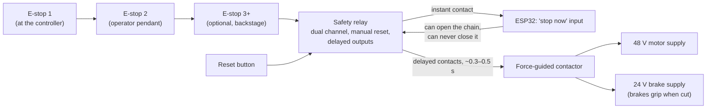
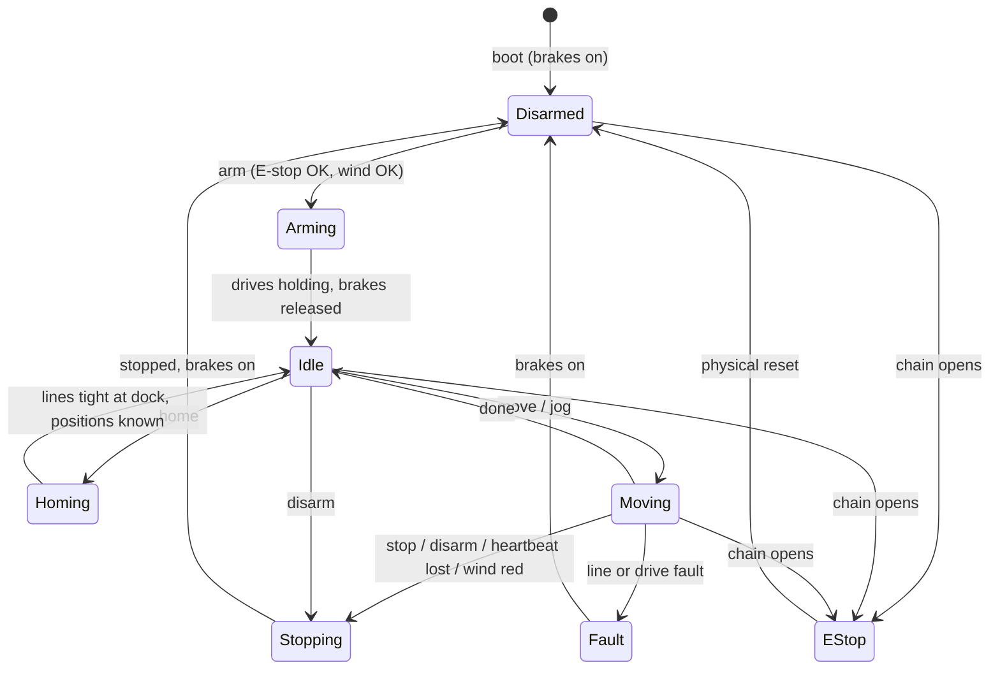

# Flying Leota: project plan

A head that floats in the air, held by four motor-driven lines. The motion controller
is an ESP32 with wired Ethernet and a local touchscreen. Show Controller controls it
over the Show Controller Motion Protocol (SCMP).

Status: research and planning. No code yet. Every "Proposed" item below needs a yes from
Nate before it is built.

## 1. Goals

| # | Goal |
| --- | --- |
| G1 | Move a head-sized prop in 3 axes (left/right, up/down, toward/away), like Skycam. A fixed-depth plane (2 axes) is an acceptable fallback. |
| G2 | Show Controller drives it over Ethernet with SCMP. No Wi-Fi anywhere in the control path. |
| G3 | A local touchscreen shows status. It also has controls to enable or disable remote control, arm and disarm, home, park and stop. |
| G4 | At least two hardwired emergency stops. They work even if the software is dead. |
| G5 | It runs outdoors under a tent, enclosed on 3 sides and seen from 1 side. It has clear wind rules and enforces them itself. |

Non-goals for version 1: turning or tilting the head, and more than one flying object.
The head's own projector and LEDs run on their own battery and are not part of the motion
controller.

### Site and prop (from Nate, 2026-11-03)

| Item | Value |
| --- | --- |
| Tent | About 8 ft × 8 ft (2.44 m). Pulleys at about 8 ft (2.44 m). The roof peaks higher, but pulleys up there would sit closer to the center and cut the travel, so 8 ft it is. |
| Dock | A pedestal fixed to a table in the middle of the tent, its top 1.0 m off the floor. The head rests here when it isn't flying. |
| Head | Lifesize, inside a clear sphere made to look like a crystal ball, about 18 in (0.46 m) across. A large curly wig. Weight not known yet. |
| Facing | **The face must always point towards the audience.** |
| On board | A Raspberry Pi Zero 2 W drives a small wide-angle projector in the neck. A mirror throws the image onto the back of the face. Maybe LEDs. All on a lithium-ion battery. No power through the lines: they stay as thin as possible. Projector not chosen yet. |
| Viewing | At night, in low light. The lines should vanish into the dark. |

This is like the séance-room crystal ball: it sits on the table, rises, drifts and floats,
and settles back. That fits the space well, because the space is small (section 4).

## 2. How it works

### Layout (proposed: Skycam style)

```
  Top view

   A (back left post) ●───────────────────────────● B (back right post)
                        ╲                       ╱
                          ╲      ┌───────┐    ╱
                            ╲────┤ head  ├──╱        each line: winch at the post base,
                            ╱────┤       ├──╲        up the post, over the top pulley,
                          ╱      └───────┘    ╲      down to one corner of the head's
                        ╱                       ╲    hidden top frame
   C (front left post) ●───────────────────────────● D (front right post)

                     ▲  audience looks in from the front (open side)
```

- Four posts at the corners of a rectangle. Each has a pulley at the top. Seen from
  above, the head is always inside that rectangle.
- Each line runs from a winch at the **base** of its post, up the post, over the top
  pulley, and down to the head. Skycam does the same thing. Heavy parts stay low and
  easy to reach, and the tops of the posts carry only pulleys.
- Gravity keeps the lines tight. The head hangs below the pulleys. It can't go above
  their plane, and it gets harder to hold as it nears that plane or a corner (section 4).
- The four lines attach to four points about 10 cm apart on a small fitting at the top
  of the ball (like the corners of Spidercam's camera dolly, but much closer together). If
  they all went to one point, the ball could spin. With four points, the face stays
  towards the audience. Section 4 explains the spacing.
- **The same hardware does both modes.** The 2-axis mode is a software setting: the
  depth axis is fixed at one value. Nothing is rebuilt to switch.

Why not the other layouts:

| Layout | Axes | Problem for this prop |
| --- | --- | --- |
| 2 lines from the top (a "polargraph") | 2 | Nothing holds the depth. A breeze from the open side swings it like a pendulum. |
| 2 lines from the top and 2 from the floor, in one plane | 2 | Stiff side to side, but depth is held only by line tension. That is the direction the wind blows through an open tent front. The floor lines are also in the scene. |
| 8 lines (fully held) | 3 + turning | Twice the hardware. Lines cross the scene from below. |
| **4 lines from the top (Skycam)** | **3, or 2** | **Recommended.** Front and back lines hold the depth directly. |

### The frame must not be the tent

Put the pulleys on their own freestanding frame inside the tent, not on the tent
poles. Tent frames move in the wind, and the lines pull inward on whatever holds them.
If the posts move, the head moves. At 8 ft, a frame of aluminum extrusion or steel
strut channel works well: four posts, a rectangle tying their tops together, and wide
ballasted feet. Section 4 gives the loads.

### Lines

The goal is lines you can't see against a black curtain, that don't stretch, and that
stay the same length all evening. Choose the line by testing (Phase 3). For now:

| Line | Visibility | Stretch and creep | Notes |
| --- | --- | --- | --- |
| Nylon monofilament (clear) | Good at any color backdrop | High. Stretches noticeably under load, creeps, and **changes length when wet or humid**. | Needs constant re-trimming. Least suited to a damp outdoor tent. |
| Fluorocarbon (clear) | Good | Lower than nylon, still meaningful | Stiff, and has memory on a drum. |
| **Braided UHMWPE (Dyneema/Spectra) fishing line, black, about 125–250 lb test** (by head weight, section 4) | Thin (roughly 0.5–0.7 mm). Disappears against black. | Very low | **Recommended starting point.** Strong for its size. Spools well on a grooved drum. |

Pick the line size from the loads in section 4. Theatre rigging commonly uses large design
factors (often 8:1 to 10:1). Section 7 lists this as an open question.

## 3. Hardware recommendations

### 3.1 Controller: ESP32-P4

The ESP32-P4 is the only ESP32 that has an Ethernet MAC and a MIPI-DSI display interface
together, with the speed to run a 7-inch UI and motion together.

| Chip | Ethernet | Display | Verdict |
| --- | --- | --- | --- |
| ESP32 (original) | Built-in MAC, RMII PHY | SPI or parallel only. A 7-inch UI is slow. | Workable, but tight. |
| ESP32-S3 | **No MAC.** Needs a W5500 over SPI. | RGB parallel works | Ethernet over SPI is slower and eats pins. |
| **ESP32-P4** | **Built-in MAC, RMII PHY** | **MIPI-DSI, 2D accelerator** | **Recommended.** Dual-core RISC-V at 360–400 MHz, 3 CAN (TWAI) controllers, 4 RMT channels (step pulses), and lots of GPIO. |

The P4 has no radio, which suits the no-Wi-Fi rule. Most P4 boards add an ESP32-C6 for
Wi-Fi. We leave it turned off.

Boards (all have Ethernet and a DSI connector):

| Board | Screen | About | Use |
| --- | --- | --- | --- |
| **Espressif ESP32-P4-Function-EV-Board** | 7" 1024×600 capacitive touch, in the kit | $55+ (board); more with the display kit | **Bench and first build.** Espressif's own board, with the best ESP-IDF board support (esp-bsp). IP101 Ethernet PHY. |
| Waveshare ESP32-P4-Module-DEV-KIT-B | 7" DSI touch, in the kit | ~$78 kit | Alternative. 40-pin GPIO header, optional PoE. |
| Olimex ESP32-P4-DevKit | Add a DSI panel | €16 | Open-source hardware. Good for the final build on a custom I/O carrier board. |
| Waveshare ESP32-P4-ETH / -POE-ETH | Add a DSI panel | $25+ | Small and simple, if we design our own carrier. |

Waveshare's all-in-one P4 touch panels (4.3", 5", 7", 10.1") have **no Ethernet**, so
they don't fit.

For the field build, plan a small **I/O carrier board** (or DIN-rail terminal breakouts)
between the ESP32 and the outside world:

- Opto-isolated 24 V inputs: E-stop chain status, reset, drive alarms (×4), and the
  Local/Remote key.
- Differential step/dir outputs (26LS31 line driver) to the drives.
- 2 CAN transceivers (drives or I/O later), 1 RS-485 transceiver (anemometer).
- A watchdog "charge pump" output. The drives' enable line stays on only while the
  firmware keeps toggling a pin. A hung ESP32 drops the enable. Classic CNC practice.
- Load cell amplifier inputs (×4).

### 3.2 Winches: motors and drives

Load numbers come from section 4. The head's weight isn't known yet, so **size the
winches for a 10 kg head**: up to 140 N on a line at the worst spot in the workspace.
Lighter heads then just run with more margin. With a 12 mm radius drum (24 mm across),
140 N is 1.7 N·m. The space is small, so the head moves slowly: 0.3 m/s line speed is about
240 rpm at the drum. A 3 N·m NEMA 23 does this directly, with no gearbox, because stepper
torque is highest at low speed. Its brake must hold at least 2 N·m.

Sizing for 10 kg instead of 5 kg costs little on the motor side: the same motor class, a
smaller drum, and maybe $100–200 more across four winches. The real cost of a heavy head is
thicker line (section 4).

**A hanging load needs brakes.** If drive power drops (E-stop, power cut, fault), an
unbraked motor lets the head fall. Use fail-safe brakes, which grip when power is
removed. Removing drive power then engages the brakes too, which matches SCMP's
"E-stop removes drive power" rule.

| Option | Per winch | For | Against |
| --- | --- | --- | --- |
| **A. Closed-loop stepper, NEMA 23, 2–3 N·m, with a 24 V fail-safe brake.** Drive: StepperOnline CL57T V4.1 class, or Leadshine CS-D507E with the CS-M22313B brake motor. 48 V DC. Step/dir input, alarm output. | ~$150–250 | **Recommended for version 1.** Simple, cheap, high holding torque, brakes available. The encoder catches missed steps, and the drive raises an alarm on following error. | No direct torque control, so line tension is managed through load cells (section 4). |
| B. Brushless servo: ODrive S1 + M8325s motor, controlled over CAN, plus a separate brake. | ~$300–350 + brake | Torque mode controls line tension directly. Motor current gives a tension reading. Hangprinter's cable printer is built this way. | More tuning. Brake and drum need custom mounts. Often out of stock. |
| C. Teknic ClearPath-SDSK integrated servo | ~$385–600 | Excellent, all in one, step/dir. | Expensive, and I found no brake option. |
| D. MKS SERVO57D (CAN or RS-485 closed-loop stepper) | ~$50–80 | Cheap. Good for bench experiments. | Thin documentation. Unproven for a hanging load. |

Recommendation: **build version 1 on Option A, and write the firmware with a drive
interface** so Option B can replace it later without changing the rest. One caveat: noise.
The audience is close, at night, in a quiet scene, and steppers hum or whine. Buy one of
each for Phase 3 (a single winch) and listen to both under load before buying four.

#### Closed-loop stepper or ODrive: the difference

Both are a motor, an encoder that measures where the shaft is, and a drive that powers the
motor. They differ in **what you tell the drive**.

**Closed-loop stepper: "be at this position."** The ESP32 sends step pulses. Each pulse
means "turn one tiny fixed angle more." The drive pushes as hard as it needs to keep the
shaft exactly where the pulses say. The encoder lets it correct a slip, and it raises an
alarm if it can't keep up. It's like telling someone "hold your hand exactly here." They
will, however hard you push, until they give up.

- It holds a hanging load firmly and simply. Steppers are strongest at low speed, which is
  all this rig needs.
- Setup is wiring and a few switches. There is almost nothing to tune.
- It never says how hard it's pulling. A tight line and a slack line look the same to it.
  So we add a load cell in each line to measure tension.
- It is cheaper, and brake versions exist.
- It hums or whines, more or less depending on the drive.

**ODrive (brushless servo): "be here," "move at this speed," or "pull this hard."** The
motor is a brushless motor, like those in drones and robots. The ODrive board controls the
current in its coils directly, many thousands of times a second, and takes commands over
CAN. Current is torque, and torque on a drum is line tension. So the ODrive can be told
"pull this line with 40 N." If something pulls harder, it gives way. If the line goes loose,
it takes up the slack. It's like telling someone "keep this rope tight with this much
force." Their hand goes wherever it must.

- It can control tension directly, and it reports current, which gives a rough tension
  reading without a load cell.
- It can act like a stiff spring around a target length: hold position, but give a little.
  That is exactly what four lines on a three-axis rig need (below).
- It is very smooth and nearly silent.
- It needs tuning: control gains, and an encoder calibration. Some setups do that
  calibration by turning the motor at power-up, which a hanging head can't allow. We
  would need an absolute encoder or a saved calibration.
- It costs about twice as much, and needs a separate brake, a custom motor mount and
  drum. Stock has been patchy.

**Why the difference matters here.** Four lines hold a head that has three axes, so one
line is always extra. If all four lines are held to exact lengths, any small error (a
pulley a few millimetres off, a line that stretched) makes one line go slack or makes the
motors fight. Something must manage tension:

| With | How tension is managed |
| --- | --- |
| Closed-loop steppers | Load cells measure each line. The firmware changes the line lengths a little, many times a second, until the tensions match what the model expects. All in our software. |
| ODrive | The drives do much of it: each line acts like a spring, or one line is run in "pull this hard" mode. Load cells become a check, not the main control. |

Both work. Steppers put the tension work in our firmware but are simple to start with.
The ODrive puts it in the drive, at the price of tuning and cost.

Winch mechanics:

- A **grooved drum with a single layer of line** (a helical groove, about 1 mm pitch).
  The radius never changes, so motor angle maps exactly to line length. An 8 m line on a
  30 mm drum is about 85 turns, about 85 mm of drum.
- A fixed **fairlead** (guide roller) a short way from the drum. It keeps the line's
  path fixed as it moves along the groove.
- A **tension sensor in each line near the winch**: three rollers in a row, with the
  middle one on a small beam load cell. Line tension is proportional to the reading,
  because the line angle over the rollers never changes. Amplifier: HX711 at 80
  samples/s to start, or ADS1232 / NAU7802 for faster readings.
- Top pulleys: small sealed-bearing sheaves on swivels, black. The line leaves the
  pulley at a point that moves a little as the head moves. The kinematics model includes
  that (section 5.3).

### 3.3 Safety hardware

The E-stop works in hardware. Software only reports it.



- **E-stop buttons:** at least two. They have red mushroom heads on yellow bases, twist to
  release, and two normally closed contacts each, wired in series. One sits on the
  controller enclosure. One is on a pendant with a long cable so the operator can stand
  where they see the head. Add one backstage if crew work there.
- **Safety relay:** a dual-channel E-stop relay with manual reset and delayed outputs
  (Pilz PNOZ, Omron G9SE, Phoenix PSR families, among others). The delay gives a
  **controlled stop first, then power off** (IEC 60204-1 "category 1"). A hanging head
  shouldn't be snapped to a halt by four brakes at full speed. The ESP32 gets an instant
  signal to decelerate. If it doesn't, the delayed contacts remove power regardless.
- **Reset** is a physical button. A software command can never reset it, which matches
  SCMP's "only a physical reset closes the chain".
- **Local/Remote key switch** (recommended, in addition to the touchscreen toggle).
  Turning the key to Local locks out network control, whatever the screen says. The
  person working on the rig keeps the key.
- **Stack light or beacon:** red = E-stop, amber = armed, flashing amber = moving,
  green = safe/disarmed. The crew can see the state in the dark without the screen.
  Sound a short horn on arm.

### 3.4 Power and enclosure

- 48 V DC supply for the drives (Mean Well, about 480–600 W), 24 V for brakes, relays
  and I/O, and 5 V for the ESP32 from the 24 V.
- An IP54 or better enclosure with the touchscreen in the door, behind a clear cover if
  rain can reach it. Glands or panel connectors for each winch. Feed it from a GFCI
  outlet.
- Drives in the main enclosure. Run motor, encoder and brake cables out to each winch
  (screened, labelled, locking connectors). Check the encoder cable length limit. If the
  posts are far apart, put each drive in a small box at its winch and send it
  differential step/dir (or CAN with Option B).

### 3.5 Wind sensor

- An RS-485 Modbus anemometer at the head's height, at the open side of the tent. A cup
  type (for example DFRobot SEN0483, under $100) is fine to start. Many cheap ones don't
  report gusts, so the firmware computes gusts itself from fast readings.
- An ultrasonic sensor (no moving parts, reports gusts) is the upgrade: ~$300–900.
- Tension sensing (3.2) is the second, more direct wind sensor. It measures what
  actually reaches the head. See section 6.

### 3.6 Rough budget (to check before ordering)

| Part | Rough cost |
| --- | --- |
| ESP32-P4 board + 7" touchscreen | $60–100 |
| 4 closed-loop stepper + drive + brake sets | $600–1,000 |
| Power supplies (48 V, 24 V) | $120–200 |
| Safety relay, contactor, 2–3 E-stops, reset, key switch, stack light | $300–600 |
| 4 load cells + amplifiers, I/O carrier board | $150–300 |
| Anemometer | $50–900 |
| Drums, pulleys, bearings, fairleads, mounts, line | $200–400 |
| Enclosure, cable, connectors | $200–400 |
| Frame (rented truss or built) | $300–1,500+ |
| **Total** | **about $2,000–5,000** |

## 4. The numbers that drive the design

A quick static model (to become a proper sizing tool in Phase 0). It uses the real tent:
pulleys at 2.44 m, set 8 cm in from each corner of the 8 ft square. The ball is 0.46 m
(18 in) across and rests on the pedestal at 1.0 m. The four lines attach to a ring 0.3 m
across on top of the ball.

### The space it can fly in

| Limit | Value |
| --- | --- |
| Ball center when docked | about 1.23 m |
| Highest ball center (top of ball 0.3 m below the pulleys) | about 1.91 m |
| **Room to rise** | **about 0.68 m** |
| **Sideways, each way from center** (0.3 m clear of the curtains) | **about ±0.69 m** |

Once clear of the table, the ball can also come down beside it. Tensions climb fast as the
top of the ball nears the pulleys, so the top limit is firm.

### What the head weighs

An 18 in acrylic sphere weighs:

| Wall thickness | Sphere weight |
| --- | --- |
| 2 mm | 1.6 kg |
| 3 mm | 2.3 kg |
| 4.5 mm | 3.5 kg |
| 6 mm | 4.7 kg |

Add the head form, projector, battery, LEDs and the attachment ring. Somewhere around
**4–8 kg** is likely.

### Line tensions by head weight

Tension scales with weight. Over the whole workspace, including gentle acceleration
(0.5 m/s²), the worst line sees about **14 N per kg of head**. Resting just off the dock,
each line carries about 4 N per kg.

| Head | Each line, just off the dock | Worst line, anywhere | Line rating at 8:1 | Torque on a 12 mm drum |
| --- | --- | --- | --- | --- |
| 3 kg | 13 N | 41 N | ~75 lb | 0.5 N·m |
| 5 kg | 21 N | 69 N | ~125 lb | 0.8 N·m |
| 8 kg | 34 N | 110 N | ~200 lb | 1.3 N·m |
| 10 kg | 42 N | 138 N | ~250 lb | 1.7 N·m |

### Is heavier more stable?

Yes, against things that push from outside. But only up to a point, and not against
everything. A second model treats the ball as a rigid body on four stretchy lines (black
braid, ball center at 1.6 m). It pushes the ball with a 22 mph (10 m/s) wind from the open
front, which is 4.6 N on an 18 in ball.

| Head | Ring 0.3 m across, weight 8 cm low: ball moves | Tilts | Twists, per small nudge* |
| --- | --- | --- | --- |
| 3 kg | 4.8 mm | 2.1° | 0.27° |
| 5 kg | 3.3 mm | 1.3° | 0.16° |
| 8 kg | 2.4 mm | 0.8° | 0.10° |
| 12 kg | 1.9 mm | 0.5° | 0.07° |
| 5 kg, but ring 0.16 m across, weight at the center | 10.7 mm | 3.1° | 0.28° |

\* A 0.05 N·m twisting push, such as an off-center gust.

What this shows:

1. **Weight helps against outside pushes:** wind, a curtain brushing a line, a tug. Doubling
   the weight cuts the movement by about a third to a half. The returns shrink: 3 → 5 kg
   is a big step, while 8 → 12 kg barely shows.
2. **Weight doesn't help with the ball's own moves.** When the ball speeds up or slows
   down, the force that makes it rock grows with its weight, and so does the force that
   steadies it. They cancel out. The rocking period (about 1.3–2 times a second) hardly
   changes with weight either. What helps here is smooth S-curve moves (section 5.3).
3. **Shape matters more than weight, and it's free.** A low center of weight (battery
   at the bottom) always helps. Spreading the attachment points wider cuts sway and
   twist too, but it makes the ball lean when it's off center. See the next section: the
   points should be about 10 cm apart, not 30 cm.
4. **Weight has real costs:** thicker line (it grows with the square root of the weight,
   so double the weight is 1.4 times the thickness, and more visible), more to fall if
   something breaks, and more pull on the frame.
5. **At sane wind levels, none of this is large.** At 10 mph the push is a fifth of the
   table's, so a 5 kg head moves under a millimetre.

**Recommendation:** aim for about **5–8 kg** from the parts themselves. Don't add ballast
for stability: get it from a low battery, the right attachment spacing and smooth
moves first. Build the
winches for 10 kg so the weight doesn't hold up ordering. Choose the line once the head is
weighed.

### Keeping the face towards the audience

A third model finds where the ball actually settles, given the four line lengths and
gravity. Two results:

- **Turning is not a problem.** Wherever the ball goes in the workspace, it stays square
  to the audience to within 0.02°. A line 2 mm too long doesn't turn it measurably either.
  The ball has no reason to turn: the layout is symmetrical, a round ball catches no
  twisting wind, and when it does turn, the attachment points swing inwards and every
  line gets longer, so gravity pulls it back.
- **Leaning is the real effect.** Off center, the lines on the near side get steeper and
  the far ones shallower. Their pull no longer balances around the ball, so it leans. How
  much depends on how far apart the attachment points are:

| Attachment points apart | Lean, 0.5 m to one side | Lean, far corner | Effort to turn the face 1° |
| --- | --- | --- | --- |
| One point | 0° | 0° | none: it spins freely |
| 6 cm | 1.6° | 3.1° | 0.07 N·m |
| **10 cm** | **2.6°** | **5.2°** | **0.11 N·m** |
| 16 cm | 4.0° | 8.2° | 0.18 N·m |
| 30 cm | 7.3° | 15.1° | 0.31 N·m |

(5 kg head, center of weight 8 cm below the ball's center. Moving the weight to 15 cm
below cuts the lean by about a sixth.)

Spacing the points wider holds the face more firmly but makes the ball lean more. **About
10 cm apart is the proposed balance.** A slight lean towards the side it drifts to may even
look natural. The real twisting pushes are tiny, so 0.11 N·m per degree holds the face to a
fraction of a degree.

The firmware must model the lean. If it worked out line lengths as if the ball stayed
level, the ball would land up to about 2 cm from where it was sent (section 5.3).

### Inside the ball: a central spine

The lines pull up to 140 N on the top fitting. Point loads like that can crack acrylic, so
the sphere shouldn't carry them on its own. Proposed:

- **A small top fitting**, black, about 10–12 cm across, holding the four line points.
  It clamps through a hole at the top of the sphere.
- **A spine** runs down from it, hidden in the wig, into the head. The head, projector,
  mirror and battery all hang from the spine. The sphere is clamped to the same fitting,
  so it adds no load path of its own.
- **The battery goes at the bottom,** in or below the neck. It is the low center of
  weight.
- **A small base fitting** at the bottom of the sphere carries the charging pads or coil
  (below) and seats the ball on the dock. A crystal ball on a stand looks right, so this
  can be part of the look.

Further points from the model:

- **Four lines, three axes: one line too many.** With all four lines set by position,
  a few millimetres of error in anchor positions or line length either makes one line
  go slack or makes them fight each other. The lines must be **tension-managed**, not just
  position-controlled. Maslow 4 (four belts, ESP32) and Hangprinter (four lines) both
  ran into this. Section 3.2 explains how the two motor options handle it. Section 5.3
  has the firmware side.
- **The posts take an inward pull** of up to about 140 N each (10 kg head), sideways at the
  top. The frame needs diagonal braces or a top rectangle that ties the posts together.
- **Low-stretch line matters.** With nylon monofilament the ball moves about twice as far
  in the same wind, and it bounces at a lower frequency.

### Wind on the ball

A smooth 18 in sphere (drag coefficient about 0.47) catches:

| Wind | Force on the ball | Share of a 5 kg head's weight |
| --- | --- | --- |
| 4.5 m/s (10 mph) | 0.9 N | 2% |
| 7 m/s (16 mph) | 2.3 N | 5% |
| 10 m/s (22 mph) | 4.6 N | 9% |

The lines won't go slack at any of these. The real limit is how it looks: the ball sways
and rocks, the curtains billow towards it, and the posts move. Wind inside a tent closed on
three sides is much lower than outside, except when it blows straight in the open front.
Section 6 turns this into rules.

### Power on board

Rough power budget (to firm up once the projector is chosen):

| Load | Power |
| --- | --- |
| Raspberry Pi Zero 2 W playing video | about 1.5–2.5 W |
| Small projector | about 2–10 W, by model and brightness |
| LEDs | about 1–3 W |
| **Total** | **about 5–15 W** |

**A full-evening battery is light.** 4 hours at 15 W is 60 Wh. Add 25% for battery ageing
and cold nights: about 75 Wh. A lithium-ion pack stores very roughly 150 Wh per kg, so
that's about **0.5 kg**. A pack for 2 hours would save only about 0.25 kg. The ball should
weigh 5–8 kg anyway, and weight at the bottom is the good kind. So a smaller pack buys
almost nothing.

**Recommendation: carry the full 4-hour pack, and charge on the dock as well.** The dock
then tops the battery up between shows and charges it overnight. Nobody has to open the
ball, and a long night or a cold one can't run it flat. The dock is a convenience, not
something the show depends on.

Charging on the dock, two ways:

| Way | For | Against |
| --- | --- | --- |
| **Spring-loaded contacts** (gold-plated pogo pins on the pedestal, pads on the ball's base) | Simple. High power, so a fast top-up. | Exposed metal outdoors: dew and dirt. The pads must line up. |
| **Inductive** (a Qi-style coil in the pedestal, another in the ball's base) | Nothing exposed. Works through the acrylic. Sealed. | Common modules give 5–15 W, so it's slower. The coils must be within a few millimetres of each other. The dock's seat lines them up. |

Either is fine with a full-evening pack. Inductive suits a damp outdoor tent better.

The controller switches dock power on only while the ball is seated and disarmed, and it
reports the ball's charge if the Pi sends it.

**Power path matters.** Many power banks cut their output for a moment when a charger is
connected or disconnected. That would reboot the Pi every time the ball lands or lifts off.
Use a battery board with proper power-path handling (a "UPS"-style board for the Pi, or a
pack whose output never drops while charging). Test it by docking and lifting while video
plays.

Other points:

- A projector in a closed sphere gets hot. Plan hidden vents, or a projector small enough
  to run cool.
- Projector candidates to evaluate: TI's DLPDLCR2000EVM (a tiny DLP projector board made
  for a Raspberry Pi, 640×360, up to 30 lumens) and its bigger sibling DLPDLCR230NPEVM
  (1080p, 100 lumens). Check that they work with a Zero 2 W, and check their throw and
  power. In a dark scene, on a small face, 30 lumens may be enough.
- The Pi Zero 2 W can be a **Show Controller follower** (design section 9). It plays its own
  copy of the media, in sync with the show, and takes cues over Wi-Fi. If Wi-Fi drops, it
  carries on by itself. Motion never depends on this link: the motion controller stays on
  Ethernet.

## 5. Software

### 5.1 Build on what, exactly

I looked at the open-source CNC and cable-robot projects. None fits as a base, but
several are good references:

| Project | What to take from it | Why not use it as is |
| --- | --- | --- |
| Hangprinter (and its RepRapFirmware and Klipper kinematics) | Cable kinematics for "translational cable robots with a central effector", including Spidercam-style layouts. Line flex compensation, pre-tension handling, ODrive torque control. | It's a G-code printer stack. It doesn't run on an ESP32 with SCMP. |
| Klipper `winch` kinematics | The basic per-line length math. | Basic, with no homing or limits. It runs on a Linux host. |
| Maslow 4 (ESP32-S3, FluidNC fork) | Four-line tension and calibration on an ESP32. Their forum is a catalog of what goes wrong with over-defined line systems. | Built for a CNC router and G-code. |
| FluidNC / grblHAL | Config, step generation and planner ideas. grblHAL has (experimental) wall-plotter kinematics. | G-code motion planning doesn't map onto SCMP's per-axis moves, timed moves, jog and heartbeat. We also need our own tension, wind and safety logic. |
| FastAccelStepper | Step pulses from hardware (RMT). It lists the ESP32-P4 at 200 kHz on RMT, marked experimental. | Use as a library, or as a reference for our own RMT driver. |

**Recommendation: purpose-built firmware** on ESP-IDF (5.3 or later, required for the
P4), in C++, with FreeRTOS tasks. LVGL 9 draws the UI, through Espressif's esp_lvgl_port.
Lay out the screens with EEZ Studio or SquareLine Studio.

### 5.2 Tasks

| Task | Core | Rate | Does |
| --- | --- | --- | --- |
| Motion | 1 (alone) | 1 kHz | Runs the per-axis motion profiles, does the kinematics (5.3), trims tension, and sends step targets. Checks every safety limit each cycle. |
| Supervisor | 1 | 100 Hz | The state machine (5.5). Watches E-stop, heartbeat, drive alarms, tensions, wind and the watchdog pin. |
| SCMP server | 0 | on demand | UDP and TCP on port 7720. Handles `seq` duplicates, acks and status (5.4). |
| Sensors | 0 | 80–100 Hz | Load cells, anemometer (Modbus), inputs. |
| UI | 0 | 30 fps | LVGL screens (5.6). |
| Config and log | 0 | on demand | Calibration in flash (NVS), an event log in RAM and on flash. |

The motion task never waits on the network, the screen or flash.

### 5.3 Kinematics and tension

- **Inverse kinematics** (every 1 ms): for head position p, each line's length is the
  distance from its pulley exit point to its attachment point on the head, plus the
  arc wrapped on the pulley. Motor angle = length ÷ drum radius.
- **The lean is part of the kinematics.** The ball leans a few degrees off center
  (section 4), which moves the attachment points. Working on a PC, a model finds the
  ball's resting pose and line lengths across the workspace. Those go into a table that
  the controller looks up and interpolates. Without it, the ball would land up to about
  2 cm off target, and the tension model would be wrong.
- **Tension management:** a slow outer loop (10–50 Hz) compares measured tensions with
  the tensions the force model predicts. It then lengthens or shortens each line by a
  small amount to match. Large errors are faults (below).
- **Flex compensation** (later): length correction for line stretch under load, as in
  Hangprinter. Small with UHMWPE line, large with nylon.
- **Workspace check:** each target, and each point on the way to it, must be inside the
  configured box, outside keep-out zones (the dock, set pieces, curtains), and in a place
  where every line can stay tight. Targets outside are refused with `out_of_range`, never
  clamped (SCMP rule 5).
- **Profiles:** S-curve (jerk-limited) per axis. Smooth starts and stops matter more
  than speed here. They keep the head from bouncing on its lines.

**Line faults** (all stop the rig):

| Fault | When |
| --- | --- |
| `slack_line` | A line's tension stays below its minimum (say 5 N) for 100 ms. |
| `overload` | A line's tension goes above its maximum (say 150 N). |
| `tension_mismatch` | The measured tension pattern doesn't match the model. This catches bad calibration, a snag on a curtain, or a broken line. |
| `drive_alarm` | A drive reports a position error. |

### 5.4 SCMP: how the rig looks to Show Controller

SCMP is per-axis, so the controller presents **Cartesian axes** rather than motors.
Show Controller never sees lines or motors.

| Axis | Units | Meaning |
| --- | --- | --- |
| `x` | mm | Left (−) to right (+), as the audience sees it. 0 is center. |
| `y` | mm | Depth. 0 is the show plane, + is upstage. **Missing in 2-axis mode.** |
| `z` | mm | Height above the floor. |

This works with SCMP version 1 as written:

- `move` on each axis runs that axis's own profile. Three `move`s with the **same
  `duration`**, sent together, give a coordinated, straight-line move. Show Controller's
  timelines already do this with move items at the same time.
- `jog` works per axis, so the joystick on Show Controller's Motion page flies the head
  like Skycam's operator does.
- Named positions ("Leota hidden", "Leota center") live in Show Controller, as design Q15
  says. Calibration (pulley positions, drum radius, workspace, tension limits, wind
  thresholds) lives in the controller, as `config` keys.

How the axes share state, since they're one machine:

- `arm`, `disarm`, `home` and `stop` act on the **whole rig**, whatever `axis` says.
  Every axis then reports the same `armed` and `homed`. One axis can't move alone while
  another is disarmed.
- Disarmed means the brakes are on. Arming enables the drives, waits for them to hold,
  then releases the brakes. Disarming does it in reverse after a controlled stop.

**Proposed SCMP additions** (version 1.1, to agree in the BEDShowController repo):

| Addition | Why |
| --- | --- |
| Error `local` | The controller is in Local mode (touchscreen toggle or key). Commands that move it, arm it, home it or change config are refused. `hello`, `heartbeat`, `status` and `stop` are always accepted. |
| Error `weather` | Wind lockout (section 6). |
| `status` fields: `"remote": true/false`, `"wind": {"speed", "gust", "level"}`, `"lines": [{"tension", "length"}]` | Show Controller can show why the rig won't arm, and log conditions. |
| Faults `slack_line`, `overload`, `tension_mismatch`, `drive_alarm`, `wind` | New fault causes, from section 5.3 and section 6. |
| Optional: one `move` with several axes (`"axes": {"x": …, "z": …}`) | Starts them at exactly the same instant, without relying on three packets landing together. Not needed on a wired LAN, but cleaner. |

Before building this, check that Show Controller's SCMP client ignores status fields it
doesn't know.

### 5.5 States



- Boot is always **Disarmed** and **not homed**. Incremental encoders don't remember
  position, and a line may have been moved by hand.
- **Heartbeat loss** only applies in Remote mode. In Local mode the operator at the screen
  is in control.
- **Homing** uses the **dock**: the pedestal on the table, at a known spot, where the ball
  rests with its lines loose. A shaped seat (a ring or cup) puts the ball in the same
  place every time. Homing reels each line in slowly until its tension reaches the
  pre-tension (say 10 N). The rig now knows every line length from the dock's position.
  It lifts 30 mm and checks that the tensions match the model. This is better than limit
  switches, which a cable robot doesn't really have. The dock is also where the ball
  charges, and where it parks overnight and in bad weather.
- **The table is a keep-out zone.** The ball may not come lower than the table top
  while it is over the table, except straight down onto the dock.

### 5.6 Touchscreen

7" landscape. Big targets, readable from a step back. Dark theme for a dark tent.

| Screen | Contents |
| --- | --- |
| **Status** (home) | A large state banner (E-STOP, DISARMED, ARMED, MOVING, FAULT). Remote: ON/OFF. Show Controller link: connected, from which address, last heartbeat. Position x/y/z. Homed. Wind: now, gust, level (green/amber/red). Four tension bars. Active faults. |
| **Controls** | Remote enable/disable. Arm and disarm (press and hold 1 s). Home. Park at dock. A large STOP. Clear fault. |
| **Jog** | Hold-to-run XY pad and Z slider, with a speed limit. Go to dock or the service position. Local mode only. |
| **Diagnostics** | Each winch: position, drive alarm, brake, tension. Every input (E-stop chain, reset, key). Network settings and counters. |
| **Setup** (PIN) | Pulley positions, drum radius, workspace box, keep-out zones, tension limits, wind thresholds, 2- or 3-axis mode. Calibration wizard. |
| **Log** | Recent events in plain sentences. |

The touchscreen STOP is a convenience, like Show Controller's stop-all. The physical
E-stops are the safety function.

### 5.7 Testing without hardware

- Build the kinematics, profiles and state machine as plain C++ with no ESP-IDF
  dependencies. Unit-test them on a PC.
- **A simulator that speaks SCMP:** the same core code built for Linux, or a cable-robot
  mode added to Show Controller's Python simulator. It shows the head and lines in 3D and
  tensions per line. Timelines can be written and checked before the frame exists.
- Run Show Controller's own SCMP client and motion module against the firmware on the
  bench to prove protocol compatibility.

## 6. Wind and weather rules (proposed)

Three levels. The firmware enforces them. Show Controller and the screen both show them.

| Level | When (starting values, to set in testing) | The rig |
| --- | --- | --- |
| **Green** | 3 s gust under 7 m/s (15 mph), and tensions steady | Full workspace and speed. |
| **Amber** | Gust 7–11 m/s (15–25 mph), or tensions start to swing | Speed limited to half. Workspace shrinks to the low center, away from curtains and corners. Warns Show Controller and the screen. |
| **Red** | Gust over 11 m/s (25 mph), **or** wind sensor fault, **or** tensions swing past the red limit | Flies to the dock, disarms, and refuses `arm` (`weather`) until conditions have stayed Green for 15 minutes. A person must re-arm it. |

- **Gust** = the highest 3-second average in the last 10 minutes. **Steady** = 2-minute
  average. Both are computed in firmware from 1 Hz or faster readings.
- **Tension swing** = how much each line's tension varies over a few seconds while the head
  stands still. It measures what actually reaches the head, including what the anemometer
  misses (a gust through the curtains, a billowing wall). It can raise the level by itself.
- A **missing or stuck sensor counts as Red.** Fail safe.
- These limits are for the prop. The tent has its own wind rating from its maker and
  local permits. If that is lower, it wins, and the tent should be cleared first anyway.
- Separate from wind: stop for lightning nearby (crew policy). Inspect lines after rain.
  Nylon line changes length when wet, another reason to prefer UHMWPE.

How to set the real numbers (Phase 5): put the anemometer next to the head. Blow on it
with a fan or leaf blower at rising speeds, at the workspace corners. Find the speed where
(a) a line drops below its minimum, (b) the head visibly moves, (c) the curtains reach the
lines. Set Amber below the lowest of those, and Red at it.

Site rules that make the numbers better:

- Face the tent's open side away from the usual wind, if you can.
- Tie and weight the curtain bottoms. Keep at least 0.3 m between the curtains and the
  ball's path. The tent is small, so every bit of curtain movement matters.
- No guests under the head or in reach of a line. Barricade the area under the workspace.

## 7. Risks and what handles them

| Failure | What happens | Covered by |
| --- | --- | --- |
| Line breaks | Head swings on 3 lines or drops | Design factor on line. Inspection and replacement schedule. `slack_line` stops the rig. Nobody under the head. |
| Power cut or E-stop | Drives lose power | Fail-safe brakes hold the head where it is. |
| ESP32 hangs | No steps, no heartbeat answer | Watchdog charge pump drops drive enable. Brakes on. ESP32 hardware watchdog reboots it. |
| Network lost | No heartbeat | Stops and disarms after 0.5 s (SCMP Q8). |
| Motor stalls or skips | One line wrong length | Drive alarm, and tension mismatch. |
| Line snags a curtain or set piece | Tensions jump | `overload` or `tension_mismatch`. Keep-out zones. Curtain clearance. |
| Frame sways | Head moves with the posts | Freestanding, ballasted frame. Tension swing raises the wind level. |
| Calibration drift (line creep, temperature) | Slowly growing tension mismatch | Re-home at the dock at the start of each show day. Tension trim. Low-stretch line. |
| Wrong command from Show Controller | Unexpected move | Soft limits, workspace checks, Local mode, and SCMP's rules. Arming by schedule only if the device allows it (Q7). |

## 8. Plan of work

| Phase | Work | Done when |
| --- | --- | --- |
| **0. Decide and measure** | Answer the open questions below. Measure the tent and set the frame size and pulley height. Weigh or estimate the head. Turn the tension script into a small sizing tool. Order the bench parts. | Frame size, head weight, workspace and motor choice are fixed. |
| **1. Bench electronics** | P4 board, Ethernet, LVGL screens with fake data. The SCMP server, tested against Show Controller's SCMP client. E-stop chain with the safety relay on a test panel. One drive and motor. | Show Controller connects, arms, jogs and stops one motor. The E-stop drops power with the ESP32 unplugged. |
| **2. Simulation** | Kinematics, profiles and state machine in C++, with unit tests. An SCMP-speaking simulator with a 3D view. | A timeline in Show Controller flies the simulated head. |
| **3. One winch** | Drum, fairlead, tension sensor, brake sequencing. Line tests (stretch, creep, visibility against black). | Tension readings are steady, brakes hold the load, and a line is chosen. |
| **4. Frame in the workshop** | The real 8 ft frame, built away from the tent, with four winches and a test weight in place of the ball. Tension trim, dock homing, workspace checks, the joystick from Show Controller. | Flies smoothly in 2-axis and 3-axis modes. Every fault in section 7 has been triggered on purpose. |
| **5. Full scale** | Full frame, real head. Tuning. Wind tests (section 6). Failure tests: E-stop at full speed, unplug Ethernet, cut power, break a line on a dummy load. | Wind levels have real numbers. All failure tests pass. |
| **6. Site and operation** | Install under the tent. Write the checklists: setup, daily start (inspect, home, test E-stops), weather checks, shutdown. Line replacement schedule. | A show runs from Show Controller with the operator on the pendant. |

## 9. Open questions

| # | Question | Why it matters |
| --- | --- | --- |
| Q1 | Answered: 8 ft tent, pulleys at 8 ft, pedestal at 1.0 m. | Gives 0.68 m of rise and ±0.69 m sideways (section 4). |
| Q2 | Ball about 18 in across; face always to the audience (answered). **What will the whole head weigh?** How thick is the sphere's wall? | Winches are sized for 10 kg. The line is chosen once the head is weighed (section 4). |
| Q3 | Pi Zero 2 W, projector in the neck with a mirror, Li-ion battery (answered). **Which projector?** Contacts or inductive charging on the dock? | Power budget, heat, and the dock design (section 4). |
| Q4 | 3-axis from the start, or 2-axis first and 3-axis later? | Same hardware. Only commissioning order changes. |
| Q5 | Option A (closed-loop steppers with brakes) or Option B (ODrive brushless with torque control)? | Cost, tuning effort and how tension is managed. I recommend A. |
| Q6 | How fast should it fly at most? | Sets drum size and motor choice. 0.3 m/s is assumed. |
| Q7 | Can guests get near or under the workspace? Where will the operator stand? | Barricades, E-stop count and pendant cable length. |
| Q8 | Design factor for the lines (theatre practice is often 8:1–10:1), and a line replacement schedule? | Line size, and so visibility. |
| Q9 | Are you happy to extend SCMP (section 5.4) in the BEDShowController repo? | `local`, `weather` and the extra status fields need it. |
| Q10 | Budget ceiling? | Picks between the options in sections 3.2 and 3.5. |

## Sources

- SCMP version 1: `docs/scmp.md` and `docs/design.md` section 11 in
  [ncory/BEDShowController](https://github.com/ncory/BEDShowController).
- ESP32-P4 boards: [Waveshare ESP32-P4 range](https://www.waveshare.com/product/esp32-related/boards-kits/esp32-p4.htm),
  [Waveshare P4 Module DEV-KIT (Electronics Lab)](https://www.electronics-lab.com/waveshare-esp32-p4-module-development-board-supports-wifi-6-bluetooth-5-dsi-display-and-ethernet/),
  [Espressif ESP32-P4-Function-EV-Board (CNX)](https://www.cnx-software.com/2024/08/07/esp32-p4-function-ev-board-development-board-launched-for-55-with-7-inch-display-and-camera-module/),
  [NuttX board page (IP101 Ethernet, 7" 1024×600 touch)](https://nuttx.apache.org/docs/latest/platforms/risc-v/esp32p4/boards/esp32p4-function-ev-board/index.html),
  [Olimex ESP32-P4-DevKit](https://www.olimex.com/Products/IoT/ESP32-P4/ESP32-P4-DevKit/),
  [ESP-IDF TWAI on ESP32-P4 (3 controllers)](https://docs.espressif.com/projects/esp-idf/en/stable/esp32p4/api-reference/peripherals/twai.html),
  [Zephyr: Waveshare ESP32-P4-ETH](https://docs.zephyrproject.org/latest/boards/waveshare/esp32p4_eth/doc/index.html).
- Step generation: [FastAccelStepper](https://github.com/gin66/FastAccelStepper).
- Drives and motors: [Leadshine closed-loop NEMA 23 with brake (DamenCNC)](https://damencnc.com/en/closed-loop-stepper-motor-with-brake-nema23-1-3nm-cs-m22313b-2phase/a5351),
  [CL57T V4.1 driver](https://ozrobotics.com/shop/closed-loop-stepper-driver-v4-1-0-8-0a-24-48vdc-for-nema-17-23-24-stepper-motor/),
  [ODrive S1 + M8325s kit](https://odriverobotics.com/shop/s1-and-m8325s-start-kit),
  [Teknic ClearPath SDSK](https://teknic.com/model-info/CPM-SDSK-2321P-RLS).
- Cable robots: [Hangprinter](https://hangprinter.org/),
  [RepRapFirmware Hangprinter kinematics](https://github.com/Duet3D/RepRapFirmware/blob/582347ea5bd945b444adede8a2f4a5d98bd45153/src/Movement/Kinematics/HangprinterKinematics.h),
  [Hangprinter 2023 blog (line forces)](https://torbjornludvigsen.com/blog/2023),
  [Klipper flex compensation for winch kinematics](https://klipper.discourse.group/t/flex-compensation-for-winch-kinematics/25031),
  [Maslow 4 forum](https://forums.maslowcnc.com/t/maslow-4-the-next-generation-of-maslow/18773),
  [grblHAL config (wall plotter kinematics)](https://raw.githubusercontent.com/grblHAL/core/master/config.h),
  [Grbl_ESP32 / FluidNC](https://github.com/bdring/Grbl_Esp32).
- Wind sensors: [DFRobot SEN0483 RS-485 wind speed](https://wiki.dfrobot.com/RS485_Wind_Speed_Transmitter_SKU_SEN0483),
  [Delta Ohm HD53LS (reports gusts)](https://www.deltaohm.com/product/hd53ls-series-high-sensitivity-anemometer-for-very-low-wind-speeds/),
  [PCE-WS US2 ultrasonic](https://www.pce-instruments.com/eu/control-systems/sensor/wind-sensor-kat_158579.htm).
