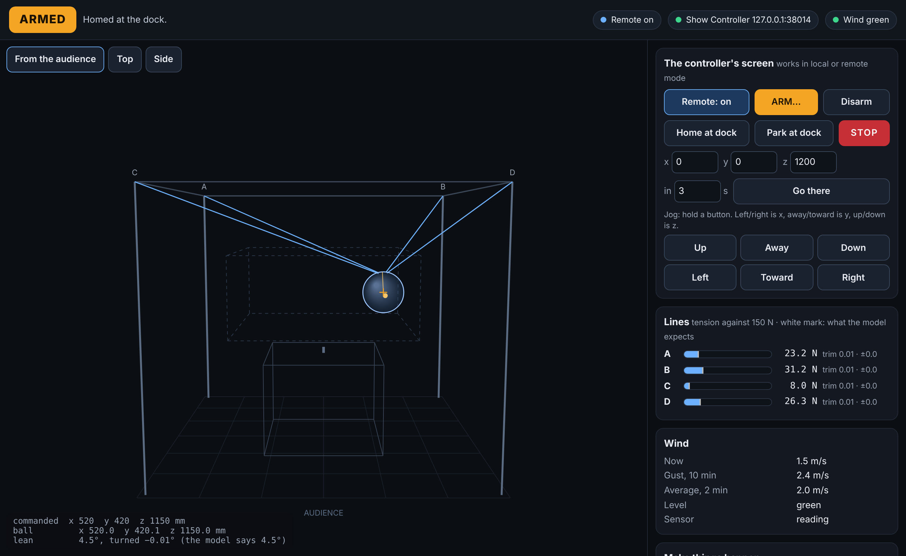
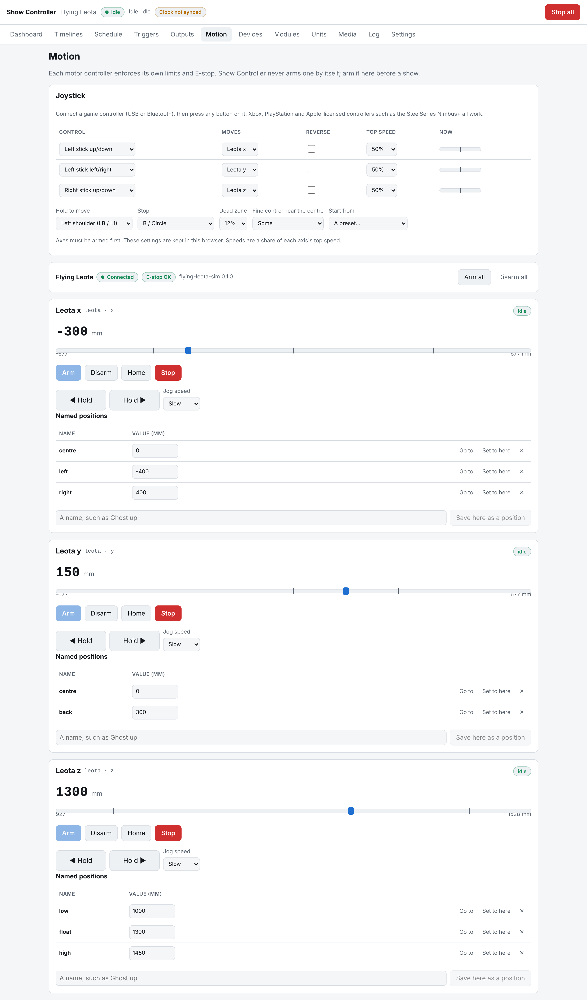

# PC simulator

`leota-sim` is the Flying Leota controller running on a PC against a simulated rig. It
speaks SCMP over UDP exactly as the real controller will, so Show Controller connects to it
as an ordinary `scmp` device. Its web page shows the rig in 3-D, has the controller's own
screen controls, and has buttons that make things go wrong on purpose.



## Build and run

From the FlyingLeota folder:

```bash
cmake -S . -B build -G Ninja
cmake --build build
build/sim/leota-sim
```

It prints:

```
SCMP on UDP port 7720
Viewer on http://localhost:8090/
ready
```

Open the viewer in a browser. In Show Controller, add a device of type **SCMP motion
controller** with the simulator's address and port 7720, then one **motion** output per
axis (`x`, `y`, `z`). On the Motion page: Arm all, then Home on any axis (homing does the
whole rig), then fly.

| Option | Does |
| --- | --- |
| `--port N` | SCMP UDP port (default 7720; 0 picks a free one) |
| `--http N` | Viewer port (default 8090; 0 picks one; -1 for none) |
| `--host ADDR` | Address to listen on (default all) |
| `--two-axis` | Fly in a fixed depth plane: no `y` axis |
| `--wind M/S` | Starting wind speed (default 2) |
| `--gusty 0..1` | How much the wind varies (default 0.3) |
| `--no-push` | The wind doesn't push the ball |
| `--pulley-error MM` | Pulley A is really this far off in x and y, to try calibration errors |

## What's simulated

- **The controller:** the motion core from `core/`, unchanged, run every 1 ms on the PC clock.
- **The rig:** four ideal drives, fail-safe brakes, an E-stop chain, stretchy lines and a
  ball that settles where the lines and gravity balance it, leaning as a real one would with
  its weight hanging below its centre. It is quasi-static: the ball doesn't swing.
- **Wind:** a speed that wanders around the set value. It feeds the wind sensor twice a
  second, and pushes on the ball from the open front (toward +y) with the drag of a 14 in
  sphere.

## The viewer

- **3-D view:** drag to turn, scroll to zoom, or pick a view. Lines turn amber when slack and
  red when overloaded. The orange cross is where the controller thinks the ball is. The
  amber dot marks the face, and the readout gives the lean, the turn, and the lean the
  controller's model expects.
- **The controller's screen:** remote on/off, arm (with the confirmation), disarm, home,
  park, STOP, go to a point, and hold-to-run jog. These work whether remote control is on or
  off, as on the real touchscreen.
- **Make things happen:** press and release the E-stop, change the wind and gustiness,
  unplug the wind sensor, snag the ball with a 60 N pull, cut or mend a line, raise a drive
  alarm, or reset everything.
- **Lines, wind, the Show Controller link, and a log** of commands and what the rig said.

The page uses the same JSON as the controller's future status screen: `GET /api/state` and
`POST /api/action` with `{"do": "arm"}` and so on.

## Tests against Show Controller

`sim/tests/test_show_controller.py` starts the simulator and points Show Controller at it:

- Show Controller's SCMP client connects, arms, homes and flies the ball, gets `late` for a
  move that's too quick, is refused with `local` when the screen takes over, and sees the
  E-stop.
- A whole Show Controller, with three motion axes, arms and homes through its own commands
  and runs a show timeline whose moves fly the ball to within 1 mm of each position.

They need a Show Controller checkout with its virtualenv:

```bash
SHOWCONTROLLER=../bedshowcontroller ../bedshowcontroller/.venv/bin/python -m pytest sim/tests
```


