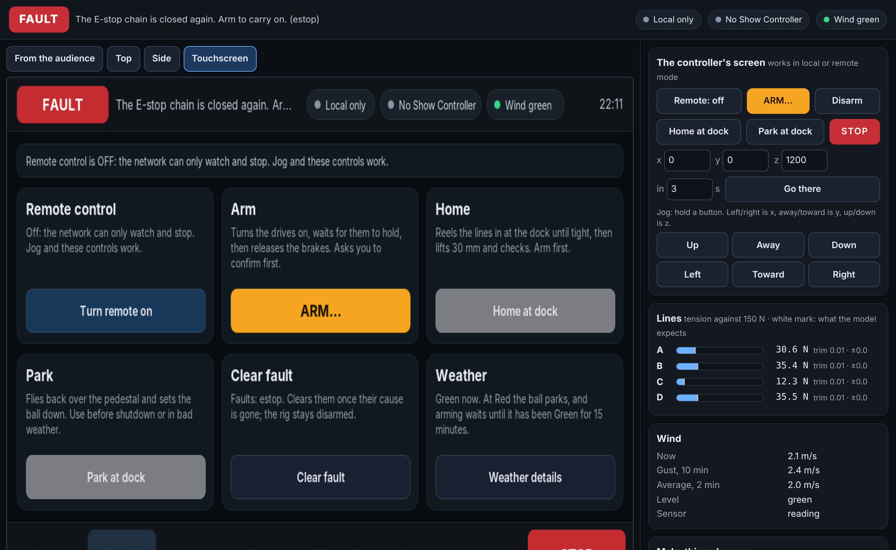
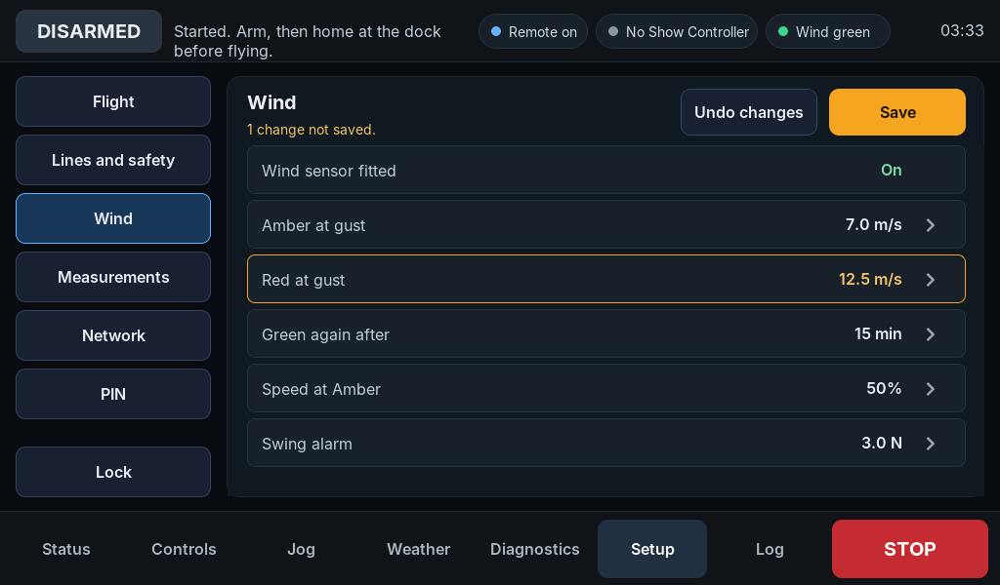
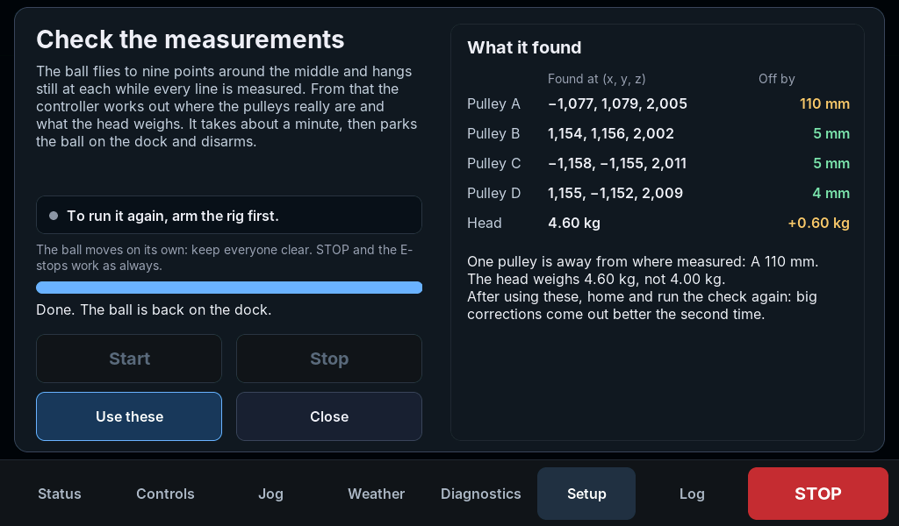
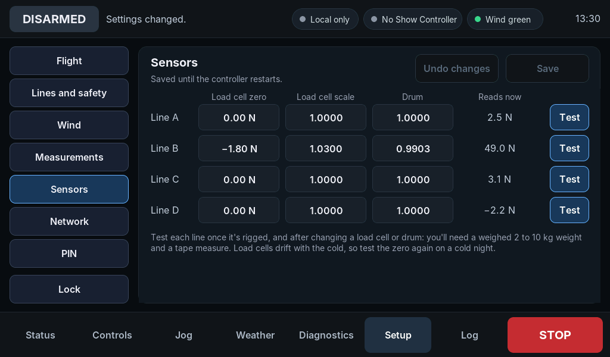
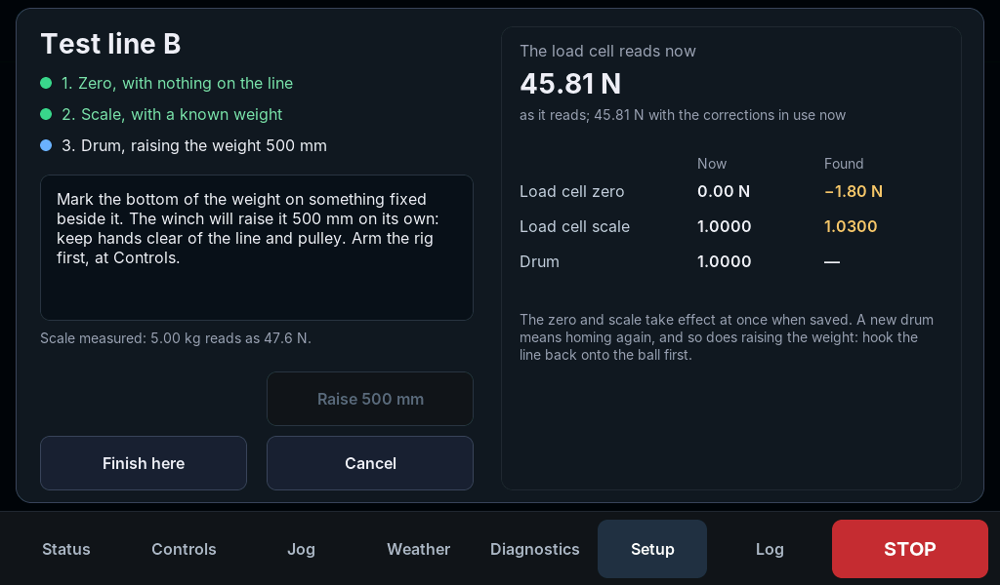

# Touchscreen

The controller's 7 in touchscreen (1024 × 600), in LVGL 9.2. The same code will run on the
ESP32-P4's panel and runs now inside the PC simulator, whose web page shows the real screen
and passes clicks through as taps. The screens follow the mockup in `docs/plan.md` section
5.6.



## Build and test

From the FlyingLeota folder, the root build includes it:

```bash
cmake -S . -B build -G Ninja
cmake --build build
build/ui/leota_ui_tests
```

CMake fetches LVGL (tag v9.2.2) with git the first time. To use a copy you already have,
add `-DLEOTA_LVGL_DIR=/path/to/lvgl`. `-DLEOTA_UI=OFF` leaves the touchscreen out, and the
simulator then has none.

## Using it

```cpp
leota::Ui ui(rig, display, &keeper);  // display: an lv_display_t of 1024 × 600
ui.update(now, link, "21:05");        // every 50 ms or so, then lv_timer_handler()
ui.log(leota::LogKind::Show, "Show Controller: move x");
```

- `keeper` is the `SettingsKeeper` (core `settings.hpp`) that holds the settings and the
  Setup PIN and keeps them in flash. Without one, Setup's changes last until a restart and
  the PIN is `1234`.
- `Ui` talks to the `Rig` directly, as the touchscreen does on the controller. It never
  goes through SCMP, so its controls work whether remote control is on or off.
- The caller owns LVGL: `lv_init()`, the tick, the display and its flush, and the touch
  input. `ui.update()` reads the rig and refreshes what's on screen; it doesn't run LVGL.
- `UiLink` says what the Show Controller link is doing (connected, address, last heard,
  command count) for the top bar and Diagnostics.
- `ui.log()` adds a line to the Log screen. The UI logs what is done at the screen and the
  rig's own messages (faults, wind, homing); the caller adds network and show events.
- `find("controls.arm")` and `page()` are for tests: every button that matters has a name.

## The screens

| Screen | Has |
| --- | --- |
| Status | Top view with the ball, lines, workspace and dock; height; x, y, z; tension bars; wind; a short system list. |
| Controls | Remote on/off, arm (with the confirmation dialog), disarm, home, park, clear fault. Buttons that can't be used say why. |
| Jog | Hold-to-run arrows for x, y and z at three speeds, and go to the dock. Only with remote control off. |
| Weather | Wind now, gust and average, the last 30 minutes' gusts against the Amber and Red lines, the levels and what each does, and the Red hold's countdown. |
| Diagnostics | Each winch's line out, tension, expected tension, drive and brake; safety inputs; wind sensor; network. |
| Setup | Behind a PIN (`1234` to start with). Every setting a person may change on site, with a check of the measurements by flying. See below. |
| Log | Tonight's events, filtered by safety, motion, wind, network and show. |

During an E-stop every screen gives way to a red one: what happened, that motor power is off
and the brakes hold, and how to recover. STOP is on every screen.

## Setup



- **Groups:** Flight (two-axis mode, workspace edges, speeds, accelerations, smoothing),
  Lines and safety (slack, overload and mismatch limits, heartbeat timeout, whether Show
  Controller may arm), Wind (sensor fitted, Amber and Red gusts, hold time, Amber speed,
  swing alarm), Measurements (pulleys, dock, head weight), Sensors (each line's load cell
  zero and scale, and drum correction), Network (DHCP or a fixed address, the SCMP port)
  and the PIN.
- **Editing:** tap a row. Numbers are typed on a number pad that shows the allowed range
  and refuses anything outside it; switches flip at a tap. Changed rows turn amber.
- **Saving:** Save checks the settings as a whole (Amber below Red, the dock inside the
  workspace, the pulleys above it, a netmask that is one, and so on), gives them to the rig
  and stores them. Anything that changes how the rig flies waits until it is disarmed;
  the network and PIN don't. A change to the pulleys, the dock or two-axis mode needs the
  ball on the dock, and then homing again. Undo changes drops the draft; so does Lock.
- **Every change goes in the log**, as "Setup: Red at gust: 11.0 m/s to 12.5 m/s."
- The settings themselves (their labels, units, ranges and help) are one table in the
  core, `settings_fields()`, so the screen, the stored JSON and the checks always agree.

### Check by flying



Measurements has **Check by flying**. With the rig armed, homed, still, remote control off
and the wind Green, the ball flies to nine points around the middle of the gazebo and hangs
still at each while the controller averages every line's tension and how much line each
winch has paid out. It then parks the ball and disarms. Those numbers only agree with one
set of pulley positions and one head weight; a least-squares fit (core `calibration.hpp`)
finds them, starting from the tape measurements. **Use these** copies them into
Measurements, to save and then home again.

In the simulator, with pulley A really 113 mm from where it was measured and the head
600 g heavier than set, one check finds both: pulley A within a few millimetres and the
weight exactly. The fit can't tell if all four pulleys turned together about the dock (that
changes nothing it can measure), so it keeps their average direction from the tape
measurements, and one big error spreads a few millimetres onto the others. A second check
after using the first cleans that up. With the load cells' noise at 0.3 N it still finds the
pulley within 15 mm.

### Sensors and the line test



The drives count line from the drum's nominal size, and the load cells read newtons from
their data sheets. Neither is exact: in the simulator, errors of 1 to 2% on the drums and
2 to 3 N on the zeros put the ball 15 mm off. Sensors holds a correction for each, and
**Test** beside each line measures them, step by step:



1. **Zero:** unhook the line from the ball and let it hang with nothing on it. Two seconds of
   readings give the load cell's zero.
2. **Scale:** hang a weighed weight (2 to 10 kg) from it, clear of the floor. Its reading
   above the zero gives the scale.
3. **Drum:** mark the weight's height. With the rig armed and remote control off, the winch
   reels in 500 mm on its own. (Raising, not lowering: from a corner pulley, a line long
   enough to reach the ball hangs nearly to the deck.) Enter how far the weight went up;
   allowing for the line's stretch under the weight, that gives the drum's correction.

**Use these** puts the three values into Sensors, to save. "Finish here" keeps what's
measured so far. Hook the line back on and home before flying. In the simulator the test
finds each zero and scale exactly and each drum to 0.1% (a millimetre in 500).

## Files

| File | Does |
| --- | --- |
| `include/leota/ui.hpp` | The `Ui` class and `UiLink`. |
| `src/ui.cpp` | Every screen, the arm dialog, Setup's number pad, the calibration check, the line test and the E-stop page. |
| `lv_conf.h` | LVGL's settings: 16-bit color, 512 KB for LVGL's heap. |
| `fonts/` | Inter at 14, 16, 20 and 28 px with a few icons. See `fonts/README.md`. |
| `tests/test_ui.cpp` | Taps through the screens against the simulated rig, through LVGL's own pointer input: arming, homing, STOP, jog, the E-stop, typing and saving settings, the PIN, a whole calibration check, and a whole line test. |

## On the ESP32-P4

Not done yet. The firmware will give LVGL a MIPI-DSI display with buffers in PSRAM, the
panel's touch controller as the pointer, and a tick from the system timer, then call
`ui.update()` from the UI task. The control loop runs in its own task, so the UI must only
read the rig and call its methods under the same lock the SCMP task uses. The firmware
gives the `SettingsKeeper` a store that writes NVS. The calibration fit takes 2 ms on a
PC; with the P4's software doubles, expect a few hundred milliseconds, once, at the end
of a check.
